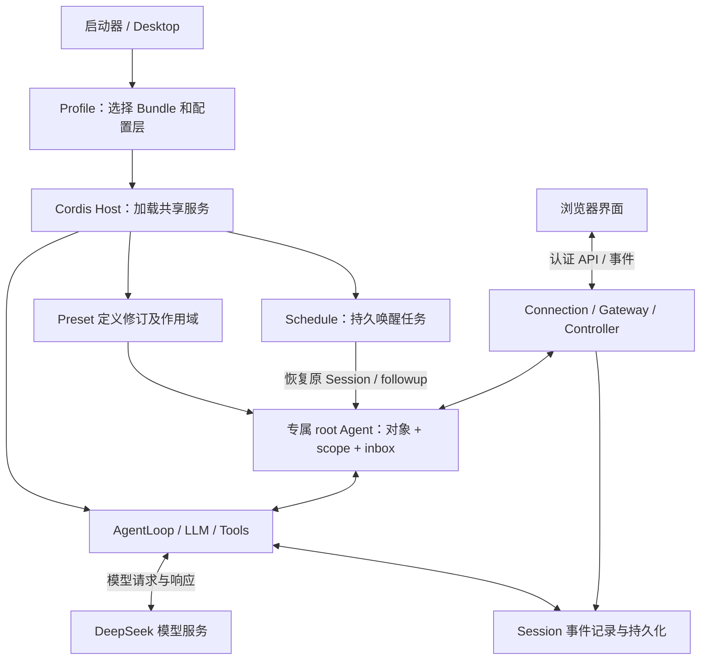
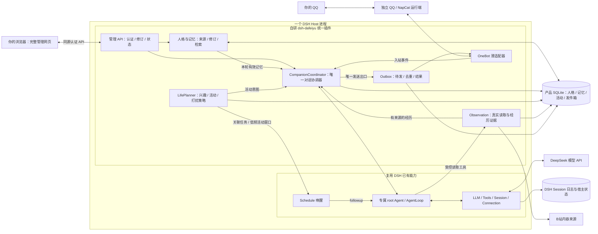
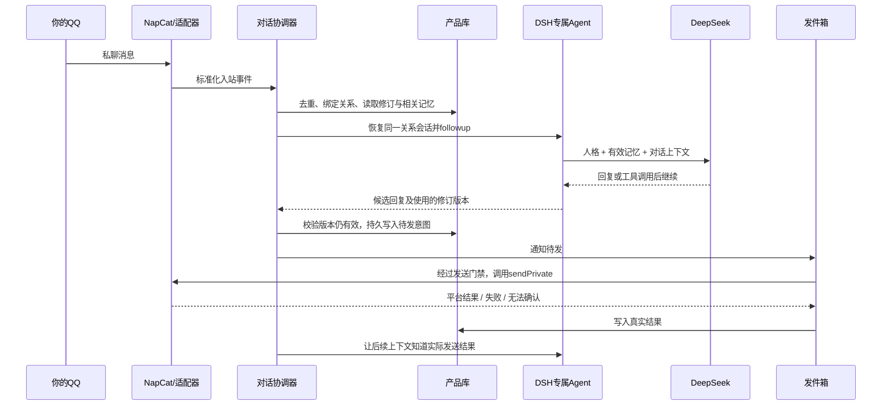
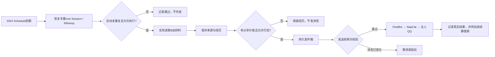
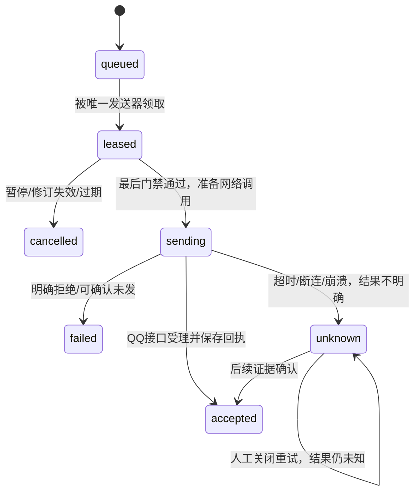
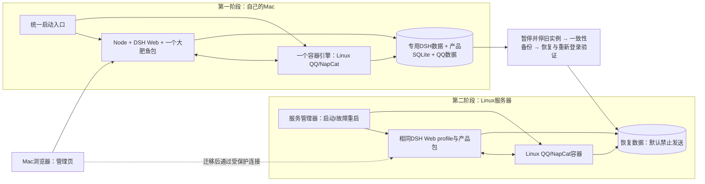

# DSH 一站式大肥鱼架构设计

2026-10-26 · 面向单主人、普通 QQ 好友、Mac 首发与后续 Linux 迁移。

**建议采用：一个统一安装/启动入口 + 一个 DSH 插件包 + 一个完整管理网页。陪伴后端采用模块化单体，在同一个 DSH Host 里运行；QQ/NapCat 保留独立运行边界。** 不引入 AstrBot 作为第二层宿主，不让用户自行组合人格、记忆、主动聊天等社区插件。AstrBot 仍保留为替代候选。

这是一份待实施的设计。蓝色/“已有”表示官方文档和源码支持；橙色/“自研”表示我们要开发的产品能力。没有安装、启动 DSH 或登录 QQ/B站；架构图不表示服务已运行。配套 [可交互架构图](架构图.html) 可以切换层级、查看节点说明和下载 SVG。

## 1. 研究依据与版本

DSH 官方采用 Cordis 的插件树架构。模型适配、工具、会话、AgentLoop 本身都是插件；扩展通常通过增加组合包完成，无需修改内核。本次复核最新发布为 `dsh-v0.2.1-rc.3`，仍为开发预览版。固定源码证据来自 `22ddee3792402c3e70ec5f86a63c3e3e895a2f60`，不能把这个 master 快照与发行包视为同一个已测试运行基线。[官方架构](https://deepseek-harness.github.io/deepseek-harness/reference/)、[发行记录](https://github.com/deepseek-ai/deepseek-harness/releases/tag/dsh-v0.2.1-rc.3)

三份专项底稿分别记录事实和设计推论：

- [DSH 真实运行结构](evidence/dsh-runtime.md)：启动、作用域、模型循环、会话、界面及调度的固定源码证据。
- [陪伴核心与状态一致性](evidence/companion-core.md)：人格、记忆、并发、发件箱、暂停与验收。
- [运行与交付架构](evidence/deployment.md)：Mac/服务器部署、依赖、版本锁和迁移。

## 2. DSH 本身怎么工作

可以把它理解为五层：**启动时组装 → 宿主提供共享能力 → 专属 Agent 处理一轮交流 → Session 记录过程 → 网页展示和管理。**

| 概念 | 在这个项目中的含义 | 容易误解的地方 |
|---|---|---|
| Profile | 一套可启动的插件组合及配置；为鱼使用独立 home 下的 Web profile | 不是鱼的人格，也不是一个数据库 |
| Bundle | 我们交付的插件包，包含后台、前端资源与配置 | 一个包可以安装多个内部模块，不要求用户分别配置 |
| Host | Node 环境里的 DSH 后台；承载模型、工具、会话、HTTP 等服务 | 内部模块通常不是各自独立进程 |
| Agent / scope | 处理对话的运行对象及注册作用范围 | 不是单独服务器；scope 也不是系统安全沙箱 |
| Preset | 专属 Agent 可用能力的组合 | 更新定义不会热替换所有已存在 Agent 的组成 |
| Session | 对话与工具事件的持久记录，用于恢复与上下文 | 不自动等于可信、可编辑的长期记忆 |
| Client | 浏览器里的界面；DSH 原生客户端有自己的插件树 | 界面不是数据权威，关闭页面不应清空鱼 |



一轮对话可以有多个步骤：收到输入，组装人格与相关记忆，调用模型；模型若请求工具，工具返回后继续下一步；最后才形成回复。上下文来自持久会话和插件贡献，不是从界面上抓取聊天气泡。[官方 turn flow](https://github.com/deepseek-ai/deepseek-harness/blob/22ddee3792402c3e70ec5f86a63c3e3e895a2f60/docs/architecture.md#L79-L114)

重要细节：Preset 的每份定义修订维护共享 scope/插件树，Agent 引用它，不是每条鱼重装整套插件。子 scope 会继承祖先注册，所以人格必须注册在专属 Agent 的范围，不能随意全局注入。[Preset Registry](https://github.com/deepseek-ai/deepseek-harness/blob/22ddee3792402c3e70ec5f86a63c3e3e895a2f60/packages/preset/agent-preset-registry/README.md#L56)

## 3. 我们的产品总架构

首版采用**模块化单体**：内部职责清楚，但不拆成一堆需要独立部署的微服务。网页资源由 DSH 自带 HTTP 服务提供；数据库是一个本地文件；QQ 通道代码属于同一个插件包。



图中的多个框不是多个需要你安装的应用。橙色模块编进一个包，后台在一个 Host 内调用；绿色数据库是本地文件。真正独立的运行端是 DSH 和 QQ/NapCat，统一启动器负责它们的环境、启动与诊断。

**单一发送出口必须落实到实现：**适配器只上报入站和执行明确的出站请求，不同时保留桥接项目原有的“模型完成就自动发”逻辑；否则普通回复与 Outbox 会双发。模型也不能通过另一个通用 QQ 工具绕过这条出口。

## 4. 每个模块具体做什么

| 模块 | 输入和输出 | 明确不承担 |
|---|---|---|
| 管理网页与 API | 人格、记忆、日记、活动、连接状态；修订时带版本号，返回实际保存结果 | 不在浏览器保管权威记忆，不直接改数据库文件 |
| CompanionCoordinator | 识别 fish/relationship，输入去重，合并同一关系事件，恢复专属会话，管理生成状态 | 不另造模型推理循环 |
| PersonaMemoryService | 核心人格锁定；记忆来源、有效时间、人工修订、候选提取和检索 | 不把外部网页评论当主人事实，不让总结任意改核心人格 |
| LifePlanner | 少量活动窗口、兴趣、活动预算、未回复抑制、安静时段；可以决定这次不联系 | 不直接网络发送，不用“每分钟思考”制造活人感 |
| ObservationService | 获取许可范围内的材料，记录获取时间、链接和实际内容范围，形成经历 | 不把标题阅读说成看完视频，不让内容变成系统指令 |
| OutboxDispatcher | 保存发送意图、校验状态/修订/目标、串行发出、保存平台结果 | 不承诺跨 QQ 网络调用恰好一次、不把已受理说成已读 |
| OneBotAdapter | 普通 QQ 入站、连接状态、受控 `sendPrivate`，返回平台 message_id/错误 | 不拥有第二套人格、记忆或自主调度 |
| DshRuntimeAdapter | Agent 创建/恢复、动态上下文、Schedule/Session 对接和能力检查 | 不把 DSH 版本差异散落到所有业务模块 |
| Launcher | 准备依赖、专用数据目录、版本锁、启停、诊断、备份迁移 | 不决定人格或是否给主人发消息 |

模块之间优先使用同进程接口和明确的业务事件；无需 Redis、消息中间件、独立向量数据库或单独前端服务器。

**冷恢复也是适配器的职责。** 专属 preset 必须持久绑定；恢复时按 `session_binding` 和当前会话代次装配人格、动态记忆与工具门禁。不能假设创建 Agent 时执行过的临时 `setup` 会在 Web SessionController 的默认恢复中自动重跑。需要时提供专属 `schedule/resolve-agent`，在能力完整挂载前拒绝业务动作；验证要覆盖宿主重启后由 Schedule 首次唤醒，而不只是界面里新建会话。

## 5. 记忆和会话如何存

选择插件自己管理的 `dafeiyu.sqlite` 作为产品状态的唯一权威库。DSH 继续管理自身 Session 与 Schedule。两种记录作用不同：Session 保存“当时发生了什么”，产品库保存“当前认可什么、哪些已纠正、哪些仍待发送”。

| 实体 | 关键字段或约束 |
|---|---|
| Companion | 稳定 fish_id、核心人格版本、用户锁定项 |
| Relationship | 主人通道身份、fish_id、relationship_id、当前 root Session 引用及 session_generation |
| Memory / Revision | 类型、内容、来源、有效期、置信/显式性、修订版本、删除/禁止重学标记 |
| Observation / Experience | 原始来源、取得时间、材料范围、摘要和推断分开保存 |
| ActivityPlan / Run | 活动目标、预算、Schedule 引用、每次发生的去重键与状态 |
| InboundEvent | 通道实例、自身账号、消息标识、已处理状态 |
| OutboxMessage | 目标、文本、来源事件与 generation_id、context epoch、幂等键、发送状态、平台结果 |
| ControlState | 主动开关、安静时段、owner binding、memory_epoch、control_epoch |

**为什么不把全部业务都塞进 DSH StorageDomain？** 它已提供 JSON/SQLite 后端和同域写队列，适合基础持久化；本产品还要把“人工修订 + 旧生成失效 + 待发消息取消”等变化放在同一个事务里，不能假定不同 domain 之间天然原子。独立 SQLite 便于这一约束和以后迁换宿主，代价是我们负责 schema、迁移与驱动兼容。[官方存储语义](https://github.com/deepseek-ai/deepseek-harness/blob/22ddee3792402c3e70ec5f86a63c3e3e895a2f60/docs/subsystems/storage.md#L126-L153)

SQLite 驱动先包在 Repository 接口内，在安装验证阶段选择与锁定 Node/平台兼容的实现；本次不虚构已验证的 Electron/Node ABI 组合。人格 Markdown、记忆 JSON 导出是审阅/备份格式，不同时充当第二个可写权威源。全文检索优先，向量检索等实际召回需求出现后再加。

## 6. 一次聊天怎么走



首版一个主人关系最多运行一个生成任务；QQ 输入与后台活动共用同一个协调器和 root Session。新的主人消息优先于尚未开始的后台活动。进行中的浏览能否中止取决于具体工具；旧生成即使返回，也要重新检查修订和控制状态后才允许入箱。

DSH Session 写入与产品 SQLite 写入不构成跨库事务。每次生成与发送带稳定事件 ID，保存“已生成、已入箱、上下文结果待同步”等检查点；启动后对账恢复，不能把两个写入放在一起就声称不会丢失或重复。[更细的时序](evidence/companion-core.md)

模型生成的候选可能在产品拒绝外发之前已经写入 DSH Session，因此必须区分 `generated_candidate` 与 `delivery_result`。后续上下文只把有发送依据的内容当作“已经对主人说过”；失效候选通过上下文过滤排除，无法可靠过滤时轮换 Session。对账按 `generation_id/outbox_id` 同步已有结果，不能为了补上下文再次发送消息。

## 7. 自己浏览、主动联系怎么走

采用 DSH Schedule 作为唯一到期唤醒来源，第一版仅安排少量活动窗口；不再增加一个同时触发相同活动的 60 秒定时器。LifePlanner 管理活动目的和预算，Schedule 管理何时唤醒。低频情况下，暂停后少量已排入 Agent 的空回合成本可以接受，但不允许外部动作穿过暂停门禁。



官方 Schedule 只保证到一定程度的会话入箱，不负责 QQ 外发，也不等待模型完成，并存在崩溃后重复投递窗口。因此每次活动必须按**任务与本次计划发生时间/活动窗口**去重，不能只用重复任务 ID，也不能用模型临时编出的 ID。实现验证须确认能从固定版本取得可靠发生标识；若不可用，需在调度适配层补明确映射，不能宣称去重完成。[官方 Schedule](https://deepseek-harness.github.io/deepseek-harness/guide/schedule)

目标去重键为 `(scheduleId, scheduledAt, relationshipId)`。同一会话多个重复任务可能合并到同一入箱消息，不能只用 `messageId`；发送记录在 followup 入箱并刷盘之后才写，也不能假设活动开始时回执已存在。适配验证必须处理这个先后顺序，无法取得可信发生信息时延后活动，不能自行猜一个标识。[官方投递记录语义](https://github.com/deepseek-ai/deepseek-harness/blob/22ddee3792402c3e70ec5f86a63c3e3e895a2f60/docs/subsystems/schedule.md#L324-L344)

调度创建/删除和产品计划写入也不是跨库事务，采用待同步状态并在恢复时核对。暂停或删除活动后，已经排入的唤醒仍要经过当前业务门禁。

## 8. 人工改记忆、暂停和发送失败

人工纠正一条记忆时，在同一 SQLite 事务中保存修订、提高 memory_epoch，并使依赖旧版本的未发送意图失效。下一次请求读取新的权威记忆；正在生成的旧结果返回后要被拒绝或重新生成。已经发给模型的请求不会因数据库改动而自动改变。

只更换动态提示不足以彻底遗忘：旧 Session 历史或压缩摘要仍可能含有被删除事实。必要时轮换专属 root Session，用筛选后的权威记忆重建，保持 fish_id/relationship_id 不变。删除、归档、从历史中禁止召回、物理清理和备份保留要在界面上明确区分；不能把移入备份目录称为彻底删除。

轮换同时提高 `session_generation`，把旧绑定标为 superseded；所有业务工具、记忆写入和外发均检查当前活动 Session 与代次。旧 Schedule 不会自动跟随新 Session，必须删除旧任务、为新 Session 重建并对账，完成前保持主动活动禁用。已经排入旧 Session 的任务即使被宿主恢复，也无权继续执行产品动作。若不能避免已含旧资料的上下文继续发往模型，先停用旧 Agent 并确认停止，再报告遗忘生效，不能只靠最后发件箱门禁。

发件箱状态建议：



`accepted` 不表示主人已收到或已读；`unknown` 不自动重发。人工决定不再重试时，保留 `delivery_status=unknown`，另记 `retry_policy=disabled`；只有确认未开始发送的项才可以标 cancelled。已经发出但回执丢失的消息无法仅靠本地事务保证恰好一次。

暂停操作和派发器共享一个发送门禁。界面确认暂停后不再启动新的发送调用；此前已经跨网络边界的调用可能仍到达，必须显示在途/结果未知。暂停不能伪装成撤回。

门禁必须覆盖“最后检查 → 写 sending → 真正启动 sendPrivate 调用”的边界；不能写完 sending 就释放门禁、稍后才调用网络。内存同步门禁不必等待整个网络响应，但暂停/修订命令必须与调用开始有明确先后。人工修订与删除也经过此边界：已在途的旧内容可能仍到达，必须如实显示，不能承诺事后改数据库会撤销远端消息。

## 9. 管理网页和“一站式”怎样落地

默认入口是完整网页 `/dafeiyu/`，由 DSH 的 HTTP 服务提供预构建资源；后台 API 复用 Connection 认证。普通静态路由不会自动获得认证，涉及记忆和配置的 API 必须正确接入认证层。DSH 客户端插件只需要提供“打开大肥鱼”入口，也可以挂原生设置页，不必再造桌面壳。[HTTP 源码](https://github.com/deepseek-ai/deepseek-harness/blob/22ddee3792402c3e70ec5f86a63c3e3e895a2f60/packages/host/webserver/src/index.ts#L439)、[Connection](https://github.com/deepseek-ai/deepseek-harness/blob/22ddee3792402c3e70ec5f86a63c3e3e895a2f60/packages/client/connection/src/rpc.ts#L146)

首次访问需走正确的认证引导：当前 Connection 的浏览器 token 交换只接受宿主 `GET /`，完成后建立 Cookie。启动入口先走宿主认证，再由客户端入口进入 `/dafeiyu/`；不能把 token 直接附在自定义子路径上就认为用户已登录。自定义自动跳转要作为前端引导实现并验收，不假定宿主有任意 redirect 参数。[官方认证说明](https://github.com/deepseek-ai/deepseek-harness/blob/22ddee3792402c3e70ec5f86a63c3e3e895a2f60/packages/client/connection/README.md#L39-L49)

页面建议只有六个日常区域：总览、人格、记忆、经历与日记、作息与主动联系、连接与维护。配置显示“已保存、待下一轮生效、需要重连、失败”等真实状态，避免保存成功却没有生效。API 凭据只存在 Host 凭据保管层，页面只显示是否已配置。

下列是产品接口设计，不是宣称 DSH 原生提供的 API：

| 产品操作 | 后台约束 |
|---|---|
| 保存人格/记忆 | 带 expected_revision；冲突返回当前版本，不能静默覆盖 |
| 暂停/恢复 | 写控制状态并经过派发门禁；返回在途项数量与状态 |
| 查看活动与消息 | 同时呈现事实、计划、成功、失败、结果未知 |
| 测试QQ连接 | 分开显示“连接正常、已登录、真实收发验收” |
| 导出/恢复 | 一致性快照，记录数据schema和运行版本；凭据单独处理 |

交付为一个预构建 bundle 和统一安装/启动入口。首次向导准备依赖、创建专用 home、生成连接配置、引导模型凭据及 QQ/B站登录，并验证真实收发。安装器与 QQ/NapCat 运行环境是交付的一部分，不能仅交付网页就声称一站式完成。[官方预构建包分发](https://deepseek-harness.github.io/deepseek-harness/develop/basic/publish)

## 10. Mac 到服务器的部署图

Mac 首选本机运行 DSH Web Host，QQ/NapCat 使用 Linux arm64 容器。容器引擎只选择一个；已有可用环境可复用。原生 Mac NapCat 保留为少一层虚拟机的备选，但需单独登录与收发验收。采用容器的代价是占用额外内存/磁盘，收益是 QQ 运行端与以后 Linux 部署更接近。



两端是先后阶段，不做同时在线双活。迁移必须停掉旧发送进程及其自动启动，再让新端取得发送权；复制出的两个数据库各自加本地锁不能保证跨机只有一个发送者。Mac arm64 到 Linux amd64 时重新准备对应二进制和镜像，迁数据，不复制 Mac 的 node_modules。

采用标准 Web profile，不能因为服务器没有桌面就直接换成缺少 HTTP/SessionController 的最小 headless 组合。管理界面关闭不影响 Host 运行，Mac 睡眠或关机则中断。服务器首版可保持 Node 系统服务 + QQ 容器，不假定已有经过我们验证的 DSH 整合镜像。[部署取舍与完整迁移步骤](evidence/deployment.md)

## 11. 关键架构决定

所有决定当前状态均为 **Proposed（待实施验证）**。

| 决定 | 选择与理由 | 放弃/代价 |
|---|---|---|
| ADR-001 宿主 | DSH Web profile + 统一 bundle，便于网页和服务器共用 | 承担预览版接口适配；AstrBot仍可替代但需另写适配 |
| ADR-002 服务拆分 | 模块化单体，一个Host内的业务模块 | 暂无独立横向扩展；首版单主人不需要微服务 |
| ADR-003 界面 | 同源完整管理网页 + DSH入口 | 自己实现界面/API；纯原生设置表单更省事但交互受限 |
| ADR-004 存储 | 产品SQLite + DSH Session各司其职 | 自己维护事务与schema；相较完全依赖storageDomain增加内部实现 |
| ADR-005 调度 | 复用DSH Schedule低频唤醒，业务门禁统一判断 | 少量空回合成本；需处理重复唤醒与跨库状态同步 |
| ADR-006 QQ | OneBot薄适配、单一Outbox出口、NapCat独立 | 通道仍需登录维护；桥接源码要适配，不能直接当稳定SDK |
| ADR-007 迁移 | 单实例停机迁移，明确转交发送权 | 有短暂停机；不做自动主备或分布式锁系统 |

## 12. 如何开始实现

建议工程目录如下，仅为拟定结构，本次没有创建可运行产品骨架：

```text
dsh-dafeiyu/
  package.json / cordis.patch.yml   # 单个组合包声明与内部模块挂载
  src/host/                       # 产品API、协调器、生命周期与恢复
  src/domain/                     # 人格、记忆、活动、发件箱；尽量不依赖宿主
  src/storage/                    # Repository、SQLite事务与schema迁移
  src/adapters/dsh/                # Agent、Session、Schedule与认证适配
  src/adapters/onebot/             # 入站归一、私聊发送与平台结果
  src/adapters/bilibili/           # 实际材料读取、来源与失败状态
  src/client/                     # 管理网页与DSH入口
  dist/                           # 发布前构建好的代码和网页
  launcher/                       # 安装、启动、诊断、升级与迁移入口
```

业务规则与 DSH 适配分开，是为了固定版本升级时集中修改少数接口；不因此宣称可以无成本切换 AstrBot。客户端资源随包构建，用户运行阶段不要求安装前端开发服务器。

| 阶段 | 做出的东西 | 通过条件 |
|---|---|---|
| 0 运行骨架 | 固定版本profile、最小bundle、完整网页、认证API、SQLite驱动探针 | Mac启动与停用成功；页面操作真实数据；未登录不能读取记忆；记录服务树和版本 |
| 1 QQ纵向链路 | 薄适配、单主人绑定、专属root会话、持久Outbox | 普通好友私聊/主动发送/续聊成立；重复事件不双发；发送结果明确记录 |
| 2 人格和记忆 | 核心人格锁定、来源记录、编辑删除、版本门禁 | 当前会话修改下一轮生效；旧生成作废；删除后不从旧摘要立即复活 |
| 3 真实经历 | 一种B站只读读取方式、经历证据、低频调度、打扰策略 | 真正取得材料；能解释看到了什么；不值得分享就不发；暂停门禁有效 |
| 4 一站式交付 | 安装/启动/状态/备份界面、固定依赖、升级回退、服务器迁移 | 新环境无需手改多处配置；重启恢复；旧端停用后仅新端发送 |

不要先铺满所有页面再验证 QQ 和会话恢复。最早要证明：一条真实 QQ 消息进入正确人格会话，回复经过唯一发送出口；网页能修改一条真实状态并在下一轮体现。

首轮必须覆盖的故障场景：重复入站、后台生成中主人发消息、人工修订发生在生成中、暂停发生在发送边界、QQ超时结果未知、重启前后Outbox恢复、Schedule重复唤醒、浏览失败、旧Session摘要含已删除记忆、迁移时旧端误启动。详细用例见 [核心验收清单](evidence/companion-core.md)。

本次交付完成的是架构研究、设计和图示。插件可运行性、QQ账号可用性、B站获取、长期相处体验、成本和真实迁移仍需按上述阶段取得运行证据。
