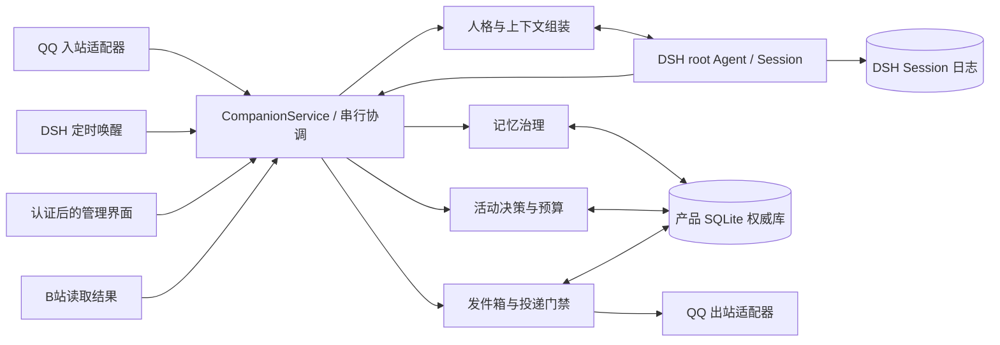
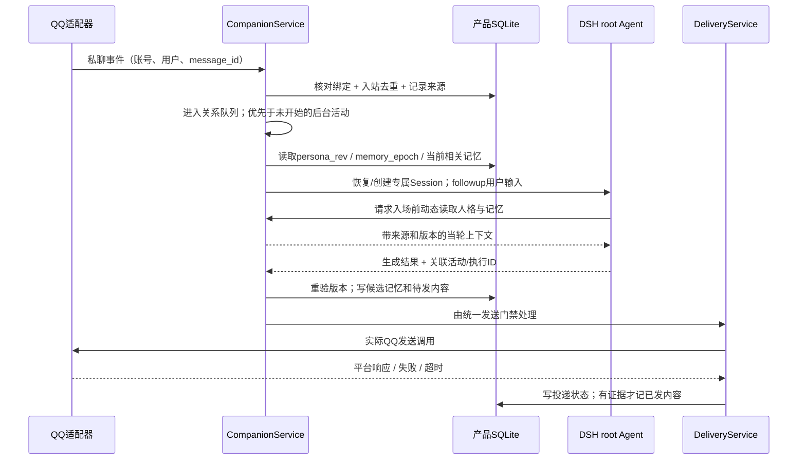
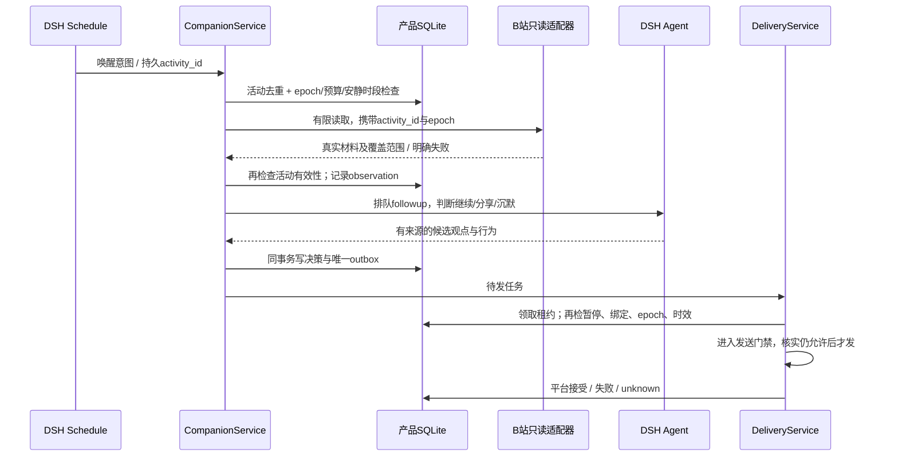
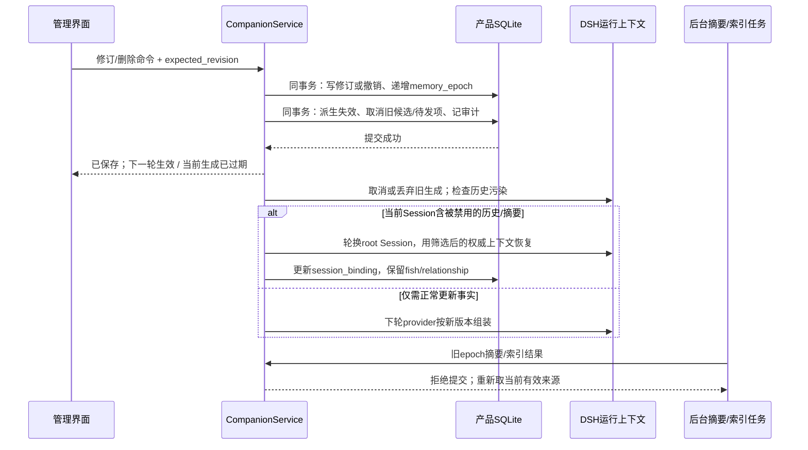

# DSH 大肥鱼陪伴核心：模块、状态与关键时序

日期：2026-10-26（Asia/Tokyo）。本文基于 `research/DSH统一陪伴插件方案.md` 与 `research/dsh-companion-check.md`，是实施架构提案；未实现、未运行验证。范围只覆盖陪伴核心，QQ协议、DSH版本、页面挂载和发布由对应适配层负责。

## 1. 核心决定

采用**模块化单体**：一个 Host 侧 `CompanionService` 管理产品状态、一个本地 SQLite 权威库、若干进程内模块、一个薄 DSH 适配层。前端、QQ桥、B站工具均不能直接写记忆或直接发消息。不要引入 Redis、独立向量数据库或第二个陪伴 Agent 运行时。

“一条鱼”由 `fish_id` 标识，“它与你的关系”由 `relationship_id` 标识，两者不随 Session 新建、压缩或重启变化。DSH Agent/Session 是可恢复或轮换的执行上下文；它不是鱼的身份，也不是唯一长期记忆。

建议一个主人的产品初版：`fish_id + relationship_id` 一条串行协调通道，所有 QQ 输入、定时唤醒、浏览完成和人工修改都进入此通道。用户输入优先；后台网络读取可以在通道外执行，但返回后必须携带任务ID和运行代次重新入队，检查仍有效后才能改变状态。不能让后台生成和 QQ 对话同时各自修改人格、记忆和关系状态。

**调度的最小决定：复用DSH Schedule提供少量固定活动窗口。** 产品`plan`只保存目标、时区、预算、有效性和对应DSH任务ID；到期时钟只有DSH Schedule一个所有者，不再创建每60秒轮询的第二套生活定时器。QQ输入和后台唤醒进入同一个专属root Session，业务工具再经CompanionService协调。低频唤醒可能带来一轮最终决定“什么也不做”的模型成本，第一版接受这一代价，先保证简单和可验证。

### 存储选择：产品 SQLite 与 DSH storageDomain

| 方案 | 已知能力与边界 | 本项目决定 |
|---|---|---|
| DSH `storageDomain` | 官方有 schema、同域写队列、原子读改写与提交后进程内通知；不能假定多个域/多份业务数据间存在事务 | 可存宿主关联设置；不据此推导完整记忆治理原子性 |
| 插件自管单个 SQLite 文件 | 可以把修订、来源撤销、任务失效与outbox取消放入明确的同一业务事务 | **作为产品权威库**，经 Repository 接口访问；无独立数据库服务 |

SQLite 事务能力是所选实现方式的要求，不是 DSH 现成替我们提供的产品保证。Node 驱动、打包、桌面/服务器兼容和备份接口留在技术验证中确定；不承诺某个 Node/Electron ABI 已兼容。不允许多个模块各自打开一个同名 storageDomain 后自行同步，也不把同一事实同时权威保存在 SQLite 和 Markdown 中。

DSH Session 日志承担模型输入输出、工具调用和执行恢复；产品数据库承担身份、经治理的记忆、证据来源、活动和实际投递状态。Session 日志可作来源引用，但不能未经筛选重新全量灌入产品记忆。原始视频资料可放插件专属文件目录，SQLite保存内容摘要、哈希、权限和来源；文件不是另一个可自行改写人格的记忆库。

## 2. 精简模块与数据模型

| 模块 | 单一职责 |
|---|---|
| `CompanionService` | 唯一入口、身份解析、队列、会话协调、事务边界、暂停与恢复 |
| `IdentityPersona` | fish/relationship、主人绑定、锁定人格、人格版本 |
| `MemoryService` | 候选事实、来源、纠正/锁定/撤销、召回、派生内容失效 |
| `LifeService` | 兴趣与当前活动、活动合法性、作息、预算、未回复抑制 |
| `DeliveryService` | 统一outbox、发送前门禁、回执、unknown、恢复处理 |
| `DshRuntimeAdapter` | 专属root Agent创建/恢复、动态provider、followup、结果归档 |
| `Repository` | 产品SQLite事务；实现细节不泄漏进业务逻辑 |

建议实体（逻辑表，非已落地schema）：

| 实体 | 最少字段与约束 |
|---|---|
| `fish` | `fish_id`、人格当前版本、运行状态、`control_epoch`；人格锁定只能由管理命令修改 |
| `relationship` | `relationship_id`、`fish_id`、主人主体ID、作息/预算；默认一对一隔离 |
| `principal_binding` | 平台实例、机器人账号、用户账号 → relationship；唯一约束；昵称不能作为身份 |
| `session_binding` | fish/relationship、DSH profile/preset、SessionId、运行代次、active/superseded；一次仅一个活动聊天绑定 |
| `inbound_event` | 平台消息ID、身份、时间、原文引用、处理状态；按通道和ID去重 |
| `source` / `observation` | 来源ID、URL或消息ID、发生/获取时间、实际覆盖范围、证据哈希、available/failed/revoked |
| `memory` / `memory_revision` | 记忆ID、类型、主体、内容、证据ID、修订、明确事实/推断、人工锁定、有效期、替代/撤销关系 |
| `derived_material` | 摘要/画像/索引缓存、来源与版本依赖、生成epoch、有效状态；均可重建，不是权威源 |
| `plan` | 目标关系、活动目标、预算/时区、有效性、DSH任务ID；不另维护独立到期时钟 |
| `activity` | 活动ID、触发ID、目标关系、计划时间、状态、租约、预算、control/memory epoch、是否仍可执行 |
| `outbox` / `delivery_attempt` | action_id、目标、消息部分序号、正文、来源依赖、epoch、有效期、状态、平台message_id/错误；唯一去重键 |
| `audit` / `erasure_rule` | 谁在何时纠正/撤销何对象、范围、旧来源禁止再学习规则；彻底删除时审计不保留被删敏感正文 |

`memory_epoch` 在人工纠正、锁定、撤销及人格变更时递增，用于阻止旧上下文的生成结果继续发出；普通新增候选不必每次触发全局中止。`control_epoch` 在暂停、恢复、主人解绑等控制变更时递增。每次执行携带快照；提交记忆或发送前重新核对，过期执行只能退出或重新计算。

一个source或revision可以被多个派生对象引用，因此删除是依赖失效问题，不能只删一条向量。向量/全文检索仅返回候选ID；最终必须用当前数据库状态过滤，再取当前内容。人工修改不能只更新缓存，版本冲突应返回当前版本并保留用户草稿。

## 3. 普通 QQ 聊天时序

MVP中QQ聊天与后台活动共用一个活动root Session，后台读取结果以有来源的观察返回，不另养一条独立人格。未来确需临时工作上下文时再单独设计它与主Session的交接。遇到长工具调用，用户消息先入队并可请求取消/降级后台任务；未拿到取消确认前，不假装后台已经停止。

DSH `inject` 只放上下文而不唤醒，活动启动需要 `followup`；不用已弃用的 `agent/request`。恢复Agent时重新挂载作用域provider和工具。修改preset定义不保证现存Agent组成立即改变，因此人格数据更新走动态读取，而不是每次改preset。

## 4. 主动浏览与分享时序

图中的Schedule→CompanionService表示**逻辑适配边界**，不声称DSH Schedule原生直接调用产品服务。已核官方语义是Schedule把followup投递到原root Session；适配层应携带activity_id，所有实际工具与外发都经CompanionService重新授权。Schedule负责时间触发，产品activity负责业务执行与幂等；不要再让另一个插件为同一活动独立定时。

重复去重键应区分一次发生与重复投递，例如“DSH任务ID + 本次计划触发时间 + 目标关系”，不能只用任务ID，否则每天的后续合法活动也会被吞掉。具体可取得的投递字段需要在Schedule适配验证中确认；无法取得稳定发生标识时，由创建任务时写入的产品触发ID补齐。`plan.trigger_id`指向DSH任务，`activity.trigger_occurrence_id`指向这一次发生。

Schedule receipt只证明会话投递层完成，不等于模型执行、B站读取或QQ发送完成。其崩溃重复投递窗口通过activity唯一约束去重。宿主恢复后的逾期任务仍要重新检查时效与预算，不补发一夜过时问候。

浏览结果只允许建立“确实获取过这些材料”的经历。只有标题就不标完整观看；获取失败不生成观看感想。外部材料不能修改人格锁、主人身份或工具权限。后台分享的真实内容写入同一关系的经历，下一次QQ追问才能接得上。

## 5. 人工纠正与删除：下一轮生效需要两层门禁

第一层是**请求入场**：动态provider每轮读取当前persona_rev、memory_epoch和经治理的记忆。第二层是**结果外发**：生成完成及发送前再次校验epoch；若人工更正发生在模型请求已发出后，旧输出失效并重新生成，不能因为“下一次provider会更新”就放行旧答复。

单靠provider无法消除已存在于Session历史/压缩摘要里的旧内容。普通纠正可保留“过去说过、现已更正”的历史并注入权威新值；涉及明确禁止使用或彻底遗忘的记录，必须检查历史依赖，必要时轮换Session，重建上下文时不从旧日志整段恢复。这样会话变了，鱼和关系没有变。

产品记忆删除与DSH原始日志删除必须分开呈现。前者可以保证后续受控检索不再使用；后者需要核实宿主删除接口及备份范围。本架构不承诺一个产品删除按钮已能擦除所有DSH日志、云端请求和备份。不可清理的范围必须在操作结果列明，不能用“已彻底遗忘”覆盖未知。

## 6. 发送unknown、暂停竞态与重启

outbox建议状态：`queued → leased → sending → platform_accepted`；旁路状态为`failed / unknown / cancelled / expired`。平台接受与手机实际展示、用户已读是三个证据层级。没有平台幂等支持时，不能承诺严格exactly-once。

发送前检查目标绑定、主动开关、control/memory epoch、来源是否撤销、安静时段、冷却、有效期。发送动作使用单一进程内门禁，与pause命令有明确先后顺序：

- pause取得门禁后，在同事务中设暂停、递增control_epoch、取消未发送主动outbox和未开始活动；返回后不得启动新的主动发送调用。
- 已在pause之前越过发送边界的调用可能仍到达QQ；取消本地等待不能证明远端没收到。界面显示“已停止新增活动；仍有1条发送结果待确认”，不能显示“已撤回”。
- 网络超时和崩溃发生在发送后、回执落库前时，恢复为unknown；先按平台message_id/可用查询或人工核实处理，不默认重发。
- 暂停期间返回的浏览/模型结果携带旧epoch，不能创建新的主动发件箱项。允许保存技术诊断或明确的实际观察，但不触发后续生活行动。
- DSH Schedule本身无产品暂停语义；暂停不必承诺取消已经排入root Session的模型轮次。已排唤醒可能结束为空操作，但浏览、记忆改写和发送等副作用都必须经过当前门禁，不再启动新的主动行动。
- 恢复是一次新的control_epoch；旧任务默认取消或由策略重新生成，不能把暂停期间所有积压消息自动放行。

“暂停主动生活”和“停止全部交流”应是两个清楚的模式。前者仍允许你主动QQ聊天；后者阻止新聊天生成与外发。哪个模式都由统一门禁落实，不能只取消Schedule却漏掉QQ工具或后台worker。

进程重启回收过期租约，sending/unknown不按queued盲目重试。插件terminate停止接收新活动，取消并await自建worker，等当前数据库事务完成后关闭连接。服务迁移只允许一个实例拥有发送权；本地单进程锁不能代替两台机器之间的单写者部署约束。

## 7. 值得画入验收图的场景

| 场景 | 应能观察到的结果 |
|---|---|
| 同fish重建Session、重启 | 身份/关系/人工记忆仍在；人格不污染其他DSH Agent |
| QQ入站重复、Schedule重复投递 | 同消息/活动只建一个业务对象；无第二次回复或分享 |
| 浏览中收到QQ | 用户输入优先；后台结果回队后不覆盖新会话状态 |
| 模型生成中人工纠正偏好 | 原请求输出不得外发；新请求用新revision，页面能显示生效情况 |
| 删除被摘要引用的记忆 | 摘要/索引/候选/outbox失效；旧后台结果无法复活；必要时轮换Session |
| 删除时旧Session仍含原文 | 不把动态provider等同清除历史；显示日志清理范围与实际状态 |
| 准备发送时点击暂停 | 以门禁顺序判定；暂停后无新调用；已在途项被诚实列出 |
| QQ已接受后本地超时/崩溃 | unknown可见，不自动重复发；已读状态不被伪造 |
| 关闭页面、宿主退出、Mac睡眠 | 页面与后台生命周期分别显示；恢复后不轰炸补发 |
| 连续插件重载、服务器切换 | 一个有效调度/发送所有者；旧租约/epoch不再有权发信 |

建议证据字段贯穿日志与页面：fish_id、relationship_id、activity_id、inbound_id、session_id、persona_rev、memory_epoch、control_epoch、outbox_id、attempt_id。技术字段放诊断详情，正常界面显示“来源、什么时候记住、修改是否生效、是否发出、为何暂停”等可理解结果。

## 8. 官方接口证据（能力存在，不代表产品保证）

- [Agent创建/恢复、作用域、followup/steer/inject](https://github.com/deepseek-ai/deepseek-harness/blob/22ddee3792402c3e70ec5f86a63c3e3e895a2f60/packages/core/agent/README.md#L28-L80)
- [系统提示与动态context provider](https://github.com/deepseek-ai/deepseek-harness/blob/22ddee3792402c3e70ec5f86a63c3e3e895a2f60/packages/core/system-prompt/README.md)
- [Preset更新与现存Agent组成](https://github.com/deepseek-ai/deepseek-harness/blob/22ddee3792402c3e70ec5f86a63c3e3e895a2f60/packages/preset/agent-preset-registry/README.md#understand-the-implementation)
- [Storage单域写入与通知边界](https://github.com/deepseek-ai/deepseek-harness/blob/22ddee3792402c3e70ec5f86a63c3e3e895a2f60/docs/subsystems/storage.md#L126-L153)
- [Schedule会话投递、恢复及重复窗口](https://github.com/deepseek-ai/deepseek-harness/blob/22ddee3792402c3e70ec5f86a63c3e3e895a2f60/docs/subsystems/schedule.md#L440-L480)

接口编译兼容、SQLite驱动、Session轮换与日志清理、QQ回执能力、pause具体锁实现均需技术验证。本文确定的是责任与必须满足的约束，不把它们描述成已实现特性。
