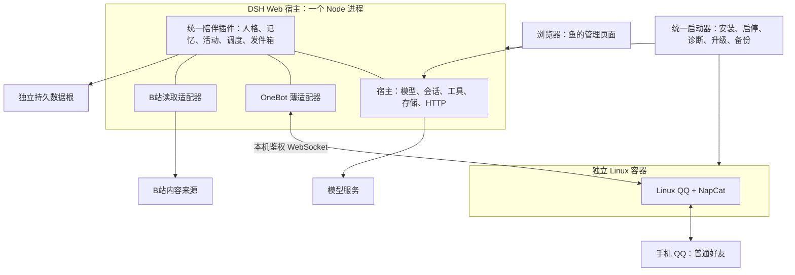

# DSH 大肥鱼运行与交付架构

日期：2026-10-26。本文是可实施的设计建议，复用本轮官方与社区源码核验；没有安装、启动或登录任何目标组件。目录、端口分配和启动器流程为拟建设计，不代表现有交付物。

## 推荐决定

**Mac 首版采用“专用 DSH Web profile + 统一陪伴插件 + Linux 容器中的 QQ/NapCat”，以一个本机启动器提供统一入口；迁到 Linux 后保持相同 profile、插件和数据格式。** 这样不依赖桌面窗口持续打开，也不需要先重写 DSH 或额外引入 AstrBot。

本机此前已只读确认为 Apple M4/arm64；尚未确认 Docker 可用或 QQ 登录成功。采用 Web profile 是为了保留客户端页面、连接和 HTTP 服务，不能把它随意换成缺少这些服务的最小 headless profile。界面是完整网页，并不意味着另起一套前端服务器。

官方 [固定版本 README](https://github.com/deepseek-ai/deepseek-harness/blob/22ddee3792402c3e70ec5f86a63c3e3e895a2f60/README.md) 明确支持 Node.js 下运行 Web 服务及不自动打开浏览器；本轮已核验插件可用 [webServer.register](https://github.com/deepseek-ai/deepseek-harness/blob/22ddee3792402c3e70ec5f86a63c3e3e895a2f60/packages/host/webserver/src/index.ts#L439) 提供专属页面。首版可挂 `/dafeiyu/`，沿用宿主认证机制，具体路由与鉴权集成仍需实施验收。

## 进程边界



| 部分 | 部署决定 | 负责什么 |
|---|---|---|
| 统一陪伴后端 | 与 DSH 同一个 Node 进程中的 Cordis 插件模块 | 一个人格权威、一套记忆写入、一套主动决策和发件箱；复用宿主会话与模型调用 |
| OneBot 适配 | 同 DSH 进程，归统一 bundle 管理 | 接入 QQ 事件，提供受控私聊端口；不用再启动一个完整机器人框架 |
| 管理 UI | 预构建静态文件由 DSH HTTP 服务提供；浏览器执行前端 | 记忆编辑、人格版本、活动和待发记录、通道状态。浏览器关闭不等于后台停止 |
| QQ/NapCat | 独立进程边界；首选 Linux 容器 | 登录个人 QQ、收发 OneBot；不能当作普通 npm 库塞入 DSH 进程 |
| B站读取 | 首版为插件内的请求/解析适配模块 | 保存来源、时间、实际取得的内容。若后续确需浏览器或音视频处理，再增加独立工作进程 |
| 启动器 | 用户启动时运行的本机控制程序 | 安装与配置、调用运行端、状态展示、备份恢复；不处理人格、不代替发件箱决定发消息 |

现有 DSH OneBot 插件证明收发路径存在，但不是稳定即插即用的跨插件服务：优先评估 [dsh-onebot 固定提交](https://github.com/mario841859784/dsh-onebot/tree/bc3aa23fcf7a11f9be7440ce2539a0a8889da3f7)，以薄分支补 `onInbound / wakeConversation / sendPrivate` 端口。其桥实例当前在插件闭包里，QQ 工具只挂对应 Agent scope；不能在独立后台 Agent 中假定直接可用。[专项核验](../../research/dsh-personal-qq-check.md) 记录了源码位置与替代候选。

## Mac 原生与容器取舍

| 方案 | 优点 | 代价与边界 | 本项目用途 |
|---|---|---|---|
| DSH 本机 Node + QQ/NapCat Linux 容器 | UI/开发直接；QQ 运行端隔离；后续 Linux 能复用部署定义与持久卷布局 | Mac 上需容器引擎及其 Linux VM；有额外资源与启动成本；仍需账号验证 | **首选** |
| DSH 本机 Node + 原生 Mac QQ/NapCat | 少一层 Linux VM；不要求先安装容器引擎 | Mac 支持较新，QQ/架构/版本组合要单独验；迁 Linux 要切运行端，登录数据不能假定直接兼容 | 容器不可用或资源约束时的备选 |
| DSH 与 QQ 都放 Linux 容器 | 最接近最终服务器拓扑，依赖隔离更完整 | 本轮未验证 DSH 产品镜像、容器 profile、浏览器认证和数据权限；Mac 文件访问较绕 | 首版稳定后再评估，不列为已经可用的预制方案 |

[NapCat-Docker 官方 README](https://github.com/NapNeko/NapCat-Docker/blob/main/README.md) 明示 Linux amd64/arm64，提供 QQ 用户目录、NapCat 配置及插件目录的持久挂载；支持正向 WebSocket，因此首版由本机 DSH 连接容器映射到 loopback 的 OneBot 端口，避免先处理容器回连 Mac 地址的差异。WebUI 与 OneBot 使用不同的认证凭据。固定镜像版本/摘要，不沿用示例的 `latest` 自动升级。

原生 Mac 不应再被写成“不支持”：官方 [NapCat v4.18.37](https://github.com/NapNeko/NapCatQQ/releases/tag/v4.18.37) 已有 macOS 相关支持与启动验证，但不等于用户账号的私聊/主动送达验收。当前 QQ 登录与桌面环境条件仍需按对应版本核查。

容器引擎只选一个。首版可适配 Docker Desktop，已有 Colima 环境可复用；不要同时把两者列为必须安装。Colima 向导是社区项目参考，不是本轮实测。Mac 睡眠、关机、引擎退出期间行为会中断；只能设计恢复，不能承诺持续在线。

## 一站式交付的实际范围

用户拿到一个启动入口和一个预构建 `dsh-dafeiyu` bundle，而不是手工依次安装人格、记忆、主动聊天等互相竞争的插件。启动器可按版本清单下载或使用已有 Node/DSH、准备专用目录、配置 QQ 通道、启动服务并打开管理页面。

它需要清楚呈现三个不同状态：**宿主可用、QQ 已登录、真实消息验收完成**。检测到 WebSocket 已连通不能显示“QQ 收发已验证”。首次账号扫码、失效后重新验证仍由用户完成；一站式不是免登录。

交付时不要求用户运行源码构建，不依赖 Git、pnpm、Python、向量数据库、Redis、独立模型服务器或 ffmpeg 来完成首版文字陪伴。开发机的构建工具与用户运行依赖分开。可选的图片、语音、视频理解若引入原生模块、浏览器或 ffmpeg，必须在能力开关中注明并单独锁定、检测。

**最小运行依赖：**选定且兼容的 Node + DSH Web profile、统一 bundle 及其已锁定运行依赖、一个模型服务连接、QQ/NapCat 运行端；采用推荐方案时再加一个容器引擎。社区 dsh-onebot 包声明 Node >=22，但这不能代替宿主/依赖组合兼容性验证；发布清单应记录经过测试的精确 Node 版本，而不是只写“大于22”。不能将这套方案宣传成零依赖。

DSH 的会话和应用存储优先复用宿主能力。发件箱需要原子状态转换；必须核实所选 `storageDomain` 后端的事务/并发保证。若达不到，再明确增加一个可事务的嵌入式存储实现并锁定跨平台驱动，不能先假定 JSON 更新或任意 storage API 天然提供事务。

## 专用 profile、数据根与版本

建议使用专用 DSH home 下的标准 Web profile，并为鱼绑定独立 Agent preset/工作区。不要混入用户平时编码使用的 DSH home。以下为拟定产品目录，不能当作 DSH 已有路径约定：

```text
data-root/
  manifest.json          # 数据schema、产品版本、当前部署身份
  dsh-home/              # DSH原有配置、会话、持久存储及profile
  companion/             # 若插件需附件/导出/证据文件，放这里
  qq/config/             # NapCat配置
  qq/user-data/          # 当前QQ运行端的数据；按平台分别管理
  qq/plugins/            # 仅保留需要的协议端插件
  observations/          # B站来源证据、正文/字幕等实际获得的内容
  logs/                  # 可裁剪日志，不作为记忆唯一来源
  backups/               # 一致性备份与恢复清单
```

实际 DSH home 覆盖参数、宿主内部目录和插件存储位置应按固定版本建立映射，不另造一套复制其内部结构的虚拟会话库。人格/记忆/人工修订/删除标记/计划/发件箱只有一个权威存储，Markdown 或 JSON 导出只是可审阅和迁移格式，不作为第二个并行可写真相源。

`runtime-lock.json` 属于安装目录，拟记录：DSH release+包完整性、Node 精确版本、统一插件及桥源码提交/包摘要、NapCat 与 QQ 对应版本、容器 manifest/各架构 digest、依赖锁、数据 schema、升级与回滚兼容范围。当前 DSH 是 developer preview，不能把本轮读到的最新版直接称为已验证基线。Mac arm64 到 Linux amd64 时重新取得对应二进制/镜像，不复制 node_modules 或 Mac 可执行文件。

密钥与普通配置分离：模型 key、OneBot token、管理认证、B站 cookie 和 QQ 登录数据不进入可分享诊断包。Mac 可使用本机凭据保管接口，服务器使用受权限限制的凭据文件或已有 secret 服务；这两者是宿主实现差异，不要求把操作系统钥匙串整个搬到服务器。备份凭据时明确是否包含、加密方式和恢复步骤；迁移后重新验证 QQ/B站登录。

## Linux 常驻与迁移顺序

Linux 第一版可继续“系统服务运行 Node/DSH Web + 独立 NapCat 容器”，保持和 Mac 相同的逻辑边界；后续再打包 DSH 镜像。服务管理器负责崩溃重启，插件负责任务状态恢复；二者不能都重新安排同一条主动消息。远程管理优先通过 SSH 转发访问本机绑定的页面，需要公网入口时再配置 HTTPS 与认证。

迁移只需要停机交接，不为单人首版引入分布式集群：

1. Mac 将主动调度与发件箱切到暂停，停止产生新的发送任务；让正在进行的发送结算，超时项标记为结果未知。
2. 停止旧 DSH 和 QQ/NapCat，关闭旧自动启动；获得一致性备份，记录校验值和最后发送状态。复制运行中的 SQLite 文件不能自动视为一致性备份。
3. 服务器按版本清单重新准备对应架构运行时，恢复 DSH 数据、插件状态、会话映射和观察证据；恢复后默认保持发送禁用。
4. 在新环境重新验证 QQ 登录和通道；重新生成/绑定 OneBot 凭据，验证主人、时区、安静时段、人工修订与删除标记。
5. 确认旧发送进程和自动启动已关闭，仅新实例启用发送。迁移前积压按到期、已发、未知分流，不把离线期间所有计划一股脑补发。
6. 做一次主动私聊与续聊验收后启用日常调度。回滚必须先停新实例再恢复旧实例，数据 schema 不兼容时恢复迁移前备份，不能直接用旧程序打开新版数据库。

**“单一发送者”是部署约束，不是给复制出的数据库各加一把本地锁就能保证。** 单机可用进程锁防重复启动；跨机迁移须明确停止/禁用旧端并转移通道控制。首版不承诺网络分区下自动主备切换；将来若要自动故障转移，必须让共同出口验证租约/代次，不能只让两个互不通信的插件各自判断自己是主实例。

## 上线前仍未验证的项目

- 固定 DSH/Node/桥插件组合在本机和目标 Linux 上可加载，Web profile 包含所需服务，停用后没有遗留定时器。
- Linux arm64 QQ/NapCat 实际登录、私聊收发、主动发送、掉线重连与 Mac 睡醒恢复；原生 Mac 备选需要独立验收。
- 主动发送进入同一 QQ 会话可见记录，用户续聊不会失去上下文；平台失败/超时不会记成已发送或盲目重发。
- 版本升级、数据备份恢复、跨架构迁移、凭据重绑，以及旧实例不能再次主动发送。
- B站读取方式的真实可用性和资源需求。浏览器或音视频工具不是默认必需品，也不能假定已有文本来源能理解整段视频。
- 启动器安装分发的许可清单：DSH MIT、桥的 MIT/BSD 与 NapCat 自身许可需分别处理；不能由桥的许可推导整个安装包可任意再分发。产品分发 QQ/NapCat 前单独核实；从上游取得组件与把其二进制重新打包是不同交付行为。

本设计的最小产品验证链：**统一入口启动 → 普通 QQ 好友私聊 → 同一人格与记忆答复 → 无入站时主动分享一次 → 续聊接得上 → 重启不丢状态、不重复发 → Mac 停用后服务器独占发送。** 这条链完成前，不宣称已交付长期常驻的完整大肥鱼。
