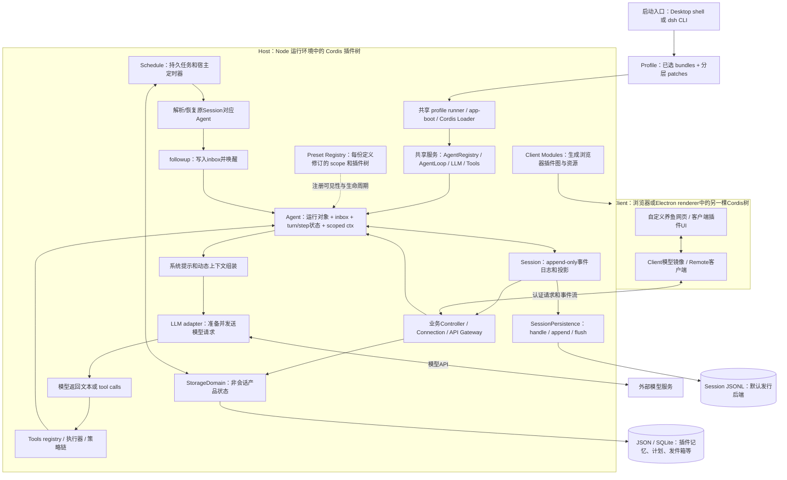

# DSH 真实运行结构：架构图证据底稿

核验日期：2026-10-26（Asia/Tokyo）。固定官方仓库修订：`deepseek-ai/deepseek-harness@22ddee3792402c3e70ec5f86a63c3e3e895a2f60`（2026-10-23T11:48:59Z）。发行参考为 `dsh-v0.2.1-rc.3`（2026-10-23，预发布）；下列结构依据固定源码与官方文档，**未启动 DSH、未做运行时追踪**。本底稿复用已有研究，只补启动、组成、作用域、循环、持久化及界面边界。

## 一句话结构

DSH 是由 Cordis 插件树组成的运行时。Launcher 按 profile 叠加 bundles 和 patches，启动 Host；Host 内共享 AgentLoop、模型适配器、工具注册与持久化能力，每个 Agent 拥有运行状态、注册作用域和 Session；浏览器/桌面界面是另一棵客户端插件树，通过 Connection/API Gateway 操作 Host。

## 可直接采用的底层拓扑



图中 Host 与 Client 是运行环境边界；Host 里的服务、scope、Agent 框并不代表各自独立进程。自定义纯 HTML 网页可直接调用适当的 Host API，不必采用完整 Client 模型层；若作为正式 DSH 客户端插件，则遵守其 Slots、Remote 与 Client 模型结构。QQ/NapCat、B 站是陪伴插件的外部适配器，不是 DSH 内核自带的一条固定流水线。

## 证据清单

| ID | 已核实的事实与图中含义 | 固定官方证据 |
|---|---|---|
| E01 | 运行中的 DSH 是启动时组成的插件树；模型适配器、工具、Session、AgentLoop 都是插件。Profile 是安装/组合容器，bundle 是配置行及其代码的发行形式，不是进程。 | [architecture.md 7–25](https://github.com/deepseek-ai/deepseek-harness/blob/22ddee3792402c3e70ec5f86a63c3e3e895a2f60/docs/architecture.md#L7-L25) |
| E02 | 层次顺序：从空列表开始 → profile 有序 bundles → profile patch → home patch → `--patch`。普通产品扩展进入 bundle；不必发布另一个后台可执行程序。`web/headless/sdk/acp` 通常在 base 上加各自界面，`sdk-minimal` 是例外。 | [architecture.md 17–47](https://github.com/deepseek-ai/deepseek-harness/blob/22ddee3792402c3e70ec5f86a63c3e3e895a2f60/docs/architecture.md#L17-L47)；[app-boot README 46–67](https://github.com/deepseek-ai/deepseek-harness/blob/22ddee3792402c3e70ec5f86a63c3e3e895a2f60/packages/boot/app-boot/README.md#L46-L67) |
| E03 | Desktop 主进程启动 Electron Node-mode Host，使用共享 profile runner 和完整 Web 应用；本地窗口加载打包页面，HTTP/WS连接认证Host。源码实际指定 `127.0.0.1`、自动端口，并生成 authenticatedUrl。 | [architecture.md 49–53](https://github.com/deepseek-ai/deepseek-harness/blob/22ddee3792402c3e70ec5f86a63c3e3e895a2f60/docs/architecture.md#L49-L53)；[Desktop Host源码 22–40](https://github.com/deepseek-ai/deepseek-harness/blob/22ddee3792402c3e70ec5f86a63c3e3e895a2f60/apps/desktop-host/src/index.ts#L22-L40) 与 [136–137](https://github.com/deepseek-ai/deepseek-harness/blob/22ddee3792402c3e70ec5f86a63c3e3e895a2f60/apps/desktop-host/src/index.ts#L136-L137) |
| E04 | AgentRegistry 是公共管理面，AgentLoop 注册 AgentFactory并提供具体driver；`create/resume` 返回拥有释放权的handle。它们创建运行对象和scope，不是每个Agent启动Node进程。 | [AgentLoop README 59–75、89–116](https://github.com/deepseek-ai/deepseek-harness/blob/22ddee3792402c3e70ec5f86a63c3e3e895a2f60/packages/core/agent-loop/README.md#L59-L116) |
| E05 | `createScope` 同时决定注册可见性与释放生命周期。子scope继承祖先注册，祖先监听可接收后代事件。它用于可信同进程插件，不是权限或系统沙箱。 | [Scope README 27–75](https://github.com/deepseek-ai/deepseek-harness/blob/22ddee3792402c3e70ec5f86a63c3e3e895a2f60/packages/core/scope/README.md#L27-L75) |
| E06 | Preset 每份声明预创建 registry-owned scope 和 Loader树；更新时旧修订被引用保留，Agent经parent scope使用注册。Host仍共享AgentLoop。服务提供方和消费者的隔离域需同一 `cordis:group`，entry-local隔离不会自动穿透Agent scope。 | [Preset Registry README 56–60](https://github.com/deepseek-ai/deepseek-harness/blob/22ddee3792402c3e70ec5f86a63c3e3e895a2f60/packages/preset/agent-preset-registry/README.md#L56-L60) |
| E07 | 一轮turn可有零至多个step；一步是模型请求及其工具执行。顺序为领取inbox→组装prompt/tools→pre-step→prepareCall→记录请求/输入→模型流→工具策略执行→结果入日志→必要时下一步。 | [官方turn flow 79–114](https://github.com/deepseek-ai/deepseek-harness/blob/22ddee3792402c3e70ec5f86a63c3e3e895a2f60/docs/architecture.md#L79-L114) |
| E08 | 模型上下文从Session日志派生，不是从UI聊天气泡抓取。持久Session事件、实时Agent事件、capability策略事件是不同域；live assistant chunks不等于每个chunk都已单独可靠落盘。 | [architecture.md 67–75、122–130](https://github.com/deepseek-ai/deepseek-harness/blob/22ddee3792402c3e70ec5f86a63c3e3e895a2f60/docs/architecture.md#L122-L130) |
| E09 | SessionPersistence提供create/open/stat/list；每会话handle负责read/append/flush/close及写入所有权。默认JSONL是可替换provider，非所有DSH部署必然有落盘。append被接纳不等于崩溃保证，flush才是耐久屏障。恢复时由Agent层补中断结束事件。 | [Persistence 5–11、67–110](https://github.com/deepseek-ai/deepseek-harness/blob/22ddee3792402c3e70ec5f86a63c3e3e895a2f60/docs/subsystems/persistence.md#L5-L110)；[AgentLoop 114–116](https://github.com/deepseek-ai/deepseek-harness/blob/22ddee3792402c3e70ec5f86a63c3e3e895a2f60/packages/core/agent-loop/README.md#L114-L116) |
| E10 | StorageDomain保存非Session事件产品状态，JSON/SQLite provider可选；同域写入串行，先确认耐久再更新内存和通知。Session日志和结构化长期记忆不能画成同一自动记忆库。 | [Storage 5–7、126–153](https://github.com/deepseek-ai/deepseek-harness/blob/22ddee3792402c3e70ec5f86a63c3e3e895a2f60/docs/subsystems/storage.md#L126-L153) |
| E11 | 浏览器是独立Cordis应用；Host拥有权威业务状态，Client模型保持镜像，UI通过Slots组成React。Client Modules扫描声明 `dsh.client` 的Host条目并生成boot graph；一个发行包可提供Host、Client入口。 | [Web Client 5–32](https://github.com/deepseek-ai/deepseek-harness/blob/22ddee3792402c3e70ec5f86a63c3e3e895a2f60/docs/subsystems/web-client.md#L5-L32)；[Client Modules 5–11](https://github.com/deepseek-ai/deepseek-harness/blob/22ddee3792402c3e70ec5f86a63c3e3e895a2f60/docs/subsystems/client-modules.md#L5-L11) |
| E12 | Connection负责物理请求/信任/认证与/api载体，Gateway负责Remote分派、取消和逻辑流；UI不应直接读本地数据库或持有Host实现。静态自定义页面也可通过正式API进入同一Host。 | [Web Client 28–38](https://github.com/deepseek-ai/deepseek-harness/blob/22ddee3792402c3e70ec5f86a63c3e3e895a2f60/docs/subsystems/web-client.md#L28-L38)；[Connection接口 146–240](https://github.com/deepseek-ai/deepseek-harness/blob/22ddee3792402c3e70ec5f86a63c3e3e895a2f60/packages/client/connection/src/rpc.ts#L146-L240) |
| E13 | Schedule在Host启动读取任务，解析/恢复原Session的Agent并followup；等待Session持久化后记投递凭据，不等模型完成，也不负责外发。Session与任务写入不原子，崩溃可重复；delegated child会话拒绝创建计划。 | [Schedule 440–480](https://github.com/deepseek-ai/deepseek-harness/blob/22ddee3792402c3e70ec5f86a63c3e3e895a2f60/docs/subsystems/schedule.md#L440-L480) |

## 一次对话与一次主动活动的真实调用链

```text
网页输入 / QQ适配器
  → Host业务控制器（识别鱼和会话）
  → root Agent.followup（写入inbox、唤醒driver）
  → AgentLoop领取消息 → systemPrompt + 相关记忆context + 可见tool schemas
  → LLM adapter请求模型
  → 文本，或tool calls → Tools策略/执行器 → tool results
  → Session事件日志 → Persistence flush
  → UI订阅呈现；如需QQ回复，由QQ适配器/发件箱实际发送

持久Schedule到期
  → Session resolver（必要时resume原会话）
  → 同一Agent.followup
  → 同一AgentLoop链路
  → 陪伴插件判断是否值得分享 → 出站发件箱 → QQ通道
```

第二条末尾的分享判断、发件箱和QQ发送属于**计划中的陪伴插件**，不是Schedule官方保证。模型请求里的记忆来自插件检索/注入；StorageDomain里有记录并不会自动进入模型上下文。

## 架构图最容易画错的九处

1. **把每条鱼/Agent画成进程**：默认是同一Host内的对象、driver状态和scope；只有明确外部执行、subprocess或另一个运行时才是进程边界。
2. **把scope当安全沙箱**：scope控制可信插件注册可见性和生命周期；工具执行安全边界由单独的权限/沙箱provider承担。
3. **把所有插件都挂进一个Agent**：模型适配器、持久化、调度、业务服务通常在Host；persona/tools可作用于Agent；UI在Client树。一包安装不意味着只有一个入口或scope。
4. **把preset画成每个Agent重新启动全部插件**：当前实现是每份preset定义/修订有共享scope和Loader树，Agent保留该组成修订。更新preset不会热改存量Agent；重启按当前ID定义恢复。
5. **把UI作为数据权威**：持久写入和业务顺序在Host；UI关闭不应删除鱼的状态。Desktop关闭主窗口可能只隐藏，完全退出或主机睡眠才中断运行。
6. **把Session日志画成长期记忆库**：前者重放对话与工具事实，后者是插件拥有的事实/经历/关系等产品状态；提取、纠错、检索、遗忘需要明确桥接。
7. **把inject画成主动唤醒**：inject仅补模型上下文；followup/steer才唤醒。Schedule使用followup，不绕过Agent直接呼叫LLM。
8. **把Schedule箭头直接连QQ**：它只可靠到一定程度地加入原会话inbox；模型完成、消息发送、幂等和回执需插件负责。
9. **把静态HTML当作后台**：HTML提供管理交互；活动循环、QQ连接、凭据、记忆写入由Host插件执行。完整网页可与后台同包分发，同一入口并不等于只有一个文件。

## 文档冲突与证据强度

- 同一固定修订的 `docs/subsystems/web-server.md` 和 `packages/host/webserver/src/index.ts` 头部注释仍有“Electron用file://＋IPC而不走此server”的旧表述；实际 `apps/desktop-host/src/index.ts` 使用 `runProfile`、`ctx.webServer.port`、`authenticatedUrl`，且主架构与Desktop README明确共享认证HTTP Host。**Desktop传输图以E03实际启动源码为准**，不要引用旧句子得出Desktop没有Web Server。
- 本文证明的是公开结构和接口语义。实际安装版本、装配后的服务树、插件兼容、启动/退出恢复、Mac QQ连接及长期运行都仍需实机验证；尚未执行配置dump或任何运行时检查。
