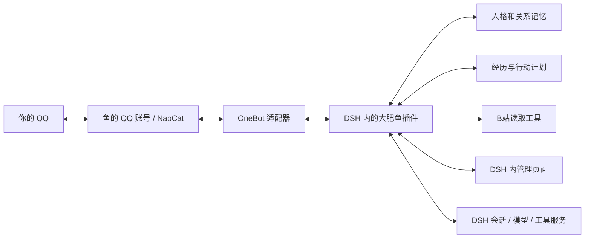

# DSH 统一陪伴插件方案

日期：2026-10-26，Asia/Tokyo。当前重点评估 DSH；AstrBot + 完整陪伴模块与管理界面保留为候选。本文为文档和源码研究及架构建议，未安装、启动 DSH，也未登录或实测 QQ/B站。

后续架构研究已整理为 [实施架构设计](../architecture/DSH一站式大肥鱼架构设计.md) 与 [可交互架构图](../architecture/架构图.html)。包括 DSH 真实运行结构、产品模块与数据、关键时序、安装和服务器迁移。

## 判断

可以做一个 `dsh-dafeiyu` 插件组合包，把人格、人工可管理记忆、经历、主动联系和管理页面作为一个产品交付。DSH 负责模型、会话、工具运行与插件生命周期；陪伴逻辑由自己的插件负责。普通 QQ 账号仍需要 NapCat 等桥接服务，不能因安装一个插件就省掉这一层。

这条路线不需要同时运行 AstrBot。两者是候选宿主，避免先叠两套会话、调度和模型调用。难度主要在陪伴行为与长期一致性，另需承担 DSH 预览版的接口适配；不会因为使用官方 Harness 自动获得更强的活人感。

官方 README 当前明确标注 developer preview、预告破坏兼容性的更新；发布查询最新为 `dsh-v0.2.1-rc.3`（2026-10-23）。DSH 使用 MIT 许可证。官方提供 Apple 芯片 Mac 桌面版，也提供 Node.js Web 运行形态。[官方 README](https://github.com/deepseek-ai/deepseek-harness/blob/master/README.md)、[发布](https://github.com/deepseek-ai/deepseek-harness/releases/tag/dsh-v0.2.1-rc.3)、[官方下载入口](https://www.deepseek.com/harness/)

## 产品应该是什么样

用户在 DSH 里安装一个“大肥鱼”组合包，打开同一个管理入口完成主人绑定、人设编辑、记忆管理、作息与浏览范围设置。日常在 QQ 与它交流，DSH 页面用于看状态、纠错和调整。

### 一站式交付约束（2026-10-26 补充）

用户明确不希望手动拼接多个人格、记忆、QQ、B站插件，也不希望在 DSH 的分散配置入口里来回修改。应交付一个自己的产品包，提供完整自定义网页管理界面；人格、记忆、日记、作息、连接和诊断在同一入口完成。

- 界面可以由 DSH 客户端插件挂载，也可以由插件的本机 Web 服务提供完整 HTML/JS 页面，在普通浏览器打开。页面通过后台接口管理真实状态；单独双击一个静态 HTML 文件不能替代持续运行的 Agent、QQ 通道与存储。
- 前端构建产物、后台模块、QQ 适配代码和默认配置应随一个预构建 bundle 交付。官方支持 npm 包或 `.tgz` 分发预构建产物，不要求用户自行构建插件。[官方打包说明](https://deepseek-harness.github.io/deepseek-harness/develop/basic/publish)
- 在所选架构中，人格、记忆、主动行为和B站连接可由自己的模块提供，不要求用户另外选择和安装一串社区插件；本地存储不要求用户部署独立数据库服务。
- 普通 QQ 好友方案的 QQ/NapCat 运行端仍然存在。安装、环境探测、连接配置和启停应由统一安装/启动向导管理；若选容器方式，Mac 的容器环境仍需准备。这部分不能靠“一个 HTML 页面”消除。
- 模型服务凭据、QQ 扫码和必要的B站登录由向导集中引导。账号验证与系统安装授权不能许诺完全无交互；登录过期仍需要用户重新验证。
- 页面关闭与后台停止应分开；如需关窗口后继续活动，交付中要包含持久后台运行方式。机器睡眠或关机时不能承诺继续活动。

当前确认的是插件/UI/打包的技术路径存在。完整一站式安装和本机真实收发尚未验收，不能把上述产品交付约束描述成已经实现。现有社区安装向导可参考 [dsh-qq-relay 环境页](https://github.com/FablerTan/dsh-qq-relay/blob/26c00fa5aa4c1faa53aead87e15e0d67a6d90d37/docs/env.md)，其依赖和扫码步骤依然存在，且该项目当前主动发送侧重群聊。

官方固定源码进一步确认 `ctx.webServer.register()` 可以由插件接管专属路径及前缀并返回 HTML/JS/CSS，适合挂 `/dafeiyu/`；不要覆盖主站唯一 fallback。当前 Desktop Host 实际通过共享 `runProfile` 启动 `127.0.0.1` 本机服务，并分配端口和认证 URL，因此无需另起独立前端服务器。[HTTP 服务源码](https://github.com/deepseek-ai/deepseek-harness/blob/22ddee3792402c3e70ec5f86a63c3e3e895a2f60/packages/host/webserver/src/index.ts#L439)、[Desktop Host 源码](https://github.com/deepseek-ai/deepseek-harness/blob/22ddee3792402c3e70ec5f86a63c3e3e895a2f60/apps/desktop-host/src/index.ts#L22)

实现上，私密记忆与配置操作应接入 DSH Connection 的认证接口，普通静态路由不自动获得认证。完整页面在系统浏览器打开；若嵌入 DSH 则使用正式客户端 UI 扩展，不能把同源地址直接塞进内置侧栏浏览器，因为后者拒绝 DSH 应用自身 origin。[Connection 源码](https://github.com/deepseek-ai/deepseek-harness/blob/22ddee3792402c3e70ec5f86a63c3e3e895a2f60/packages/client/connection/src/rpc.ts#L146)、[侧栏浏览器限制](https://github.com/deepseek-ai/deepseek-harness/blob/22ddee3792402c3e70ec5f86a63c3e3e895a2f60/packages/client/ui-sidebar-browser/README.md#L28)

插件内部可以分 Host、Agent 和 Client 部分，安装与配置对外统一。一个伙伴必须有独立且稳定的身份标识；会话可以轮换、压缩、重开，但不能把“同一条鱼”简单等同于“永远不结束的一条会话”。QQ 聊天、后台浏览和主动分享都读写同一套伙伴状态。

建议用独立 DSH profile 和数据目录运行这条鱼，配置专用 Agent preset，避免日常编码任务与陪伴会话混在一起。只开放陪伴需要的能力。可复用的记忆、关系、活动决策逻辑尽量少依赖宿主接口，DSH 适配和未来 AstrBot 适配各自封装；更换宿主仍需开发与验收，不能承诺一键切换。

## 能复用什么，还要写什么

| 目标 | DSH 可复用的底层 | 自己需要负责 |
|---|---|---|
| 性格人格 | Agent、preset、system prompt 扩展 | 稳定核心人格、表达示例、变化范围、版本与人类锁定 |
| 可管理记忆 | 会话事件、存储、工具与 UI 扩展 | 有来源的事实、推断标注、纠正、删除、召回、当前会话生效 |
| QQ 私聊 | 插件工具与社区 OneBot 桥 | 身份绑定、主人范围、会话映射、回复与主动消息的一致记录 |
| 外部经历 | 工具调用、网页能力、社区 B站插件 | 实际读取证据、兴趣选择、预算、经历沉淀与分享理由 |
| 自发活动 | 宿主任务、Schedule、Agent 续跑 | 值得联系的判断、安静时段、未回复抑制、去重与暂停 |
| 一站化界面 | 客户端 slots、设置页及 API | 人格/记忆/经历/活动/连接状态页面和操作反馈 |

上述为实现设计，并非宿主已经实现了整套陪伴产品。[官方插件入门](https://deepseek-harness.github.io/deepseek-harness/develop/basic/)、[官方架构参考](https://deepseek-harness.github.io/deepseek-harness/reference/)

官方增量核验进一步明确：为鱼创建专属 root Agent，在该 Agent 的作用域注册人格与工具；`inject` 仅加入上下文，不会唤醒，主动活动需走 `followup`。修改 preset 定义只影响后来创建的 Agent，已有 Agent 不会自动换组成，因此人格和记忆修订应通过动态 provider/上下文刷新。不要把需要长期自主活动的鱼实现成短期被委派的 child Agent。固定官方修订和具体限制见 [官方能力增量核验](dsh-companion-check.md)。

## 新发现的陪伴参考及边界

`s867968286/dsh-companion` 是很接近目标的参考：MIT，package 版本 1.0.0，本次读取的仓库 head 为 `ca28c1ceb99ac4e0a97de82c9452dafc5b2747a4`。README 与选定源码都有实际的人格注入、Markdown 人格/记忆文件、日志、后台回顾和“伙伴设置”页面。客户端注册 `settings.section`，有真实文件保存接口；不是只有概念说明。

但有几处不能原样当作需求已经满足：

- `src/core.js:413–503` 将六个文件合成的提示词按会话冻结。人工修改记忆后，该注入内容在当前会话不会自动刷新；这是插件自己的缓存策略，不是 DSH 的必然限制。自研时建议稳定人格与动态记忆分开，并让修订版本在下一轮生效。
- README 允许后台改写 `SOUL.md` 和 `IDENTITY.md`。自研版本应明确哪些人格项只能由人修改，哪些兴趣与状态可以自然变化。
- README 的“删除伙伴”是移到备份目录，属于归档语义，不等于彻底删除全部相关数据。
- 其包中的部分官方依赖仍为 `0.1.7-rc.2`，不能据此宣称最新 DSH 已兼容；本轮没有运行它的测试或插件。

[项目与说明](https://github.com/s867968286/dsh-companion)、[冻结提示词源码](https://github.com/s867968286/dsh-companion/blob/ca28c1ceb99ac4e0a97de82c9452dafc5b2747a4/src/core.js#L413)、[管理页面源码](https://github.com/s867968286/dsh-companion/blob/ca28c1ceb99ac4e0a97de82c9452dafc5b2747a4/client/client.js#L1211)

`Alterssss/dsh-bili-whale` 可参考作息、两本日记、兴趣与沉默后减少分享的设计。其 README 仍明确表示起源于 Windows + DSH + 微信工作流，自带测试不验证真实 DSH 兼容与 B站可用性；还依赖 `sessionController/webServer/connection`，其无界面模式说明指出这些服务缺失。因此服务器迁移应核对 profile 服务组合，而非简单改成 headless 启动。[项目说明](https://github.com/Alterssss/dsh-bili-whale)

## 普通 QQ 好友已经有接入参考

本次发现新的源码证据，可以提升此前仅检查旧桥接项目时的判断：DSH 已有普通 QQ 私聊与主动发送路径，不必加入 AstrBot，也不必把产品换成官方机器人身份。

- `mario841859784/dsh-onebot` 0.9.6：有私聊路由、持久会话映射和 OneBot 出站实现，适合优先评估为通信底座。但桥实例为插件局部对象，尚未提供独立陪伴插件可直接调用的稳定发送服务，需要补薄接口。
- `flyinstar/dsh-qq-bridge` 0.2.0：`qq_send_message` 明确接受 `private` 并调用 `send_private_msg`，可以由后台 Agent 发私聊。现成空闲主动规则只处理群聊，私聊补话也不是长期活动调度；它还带有自己的记忆与行为模块，整合时要避免重复决策。
- `FablerTan/dsh-qq-relay` 0.25.6：Mac/Colima 安装向导值得参考，当前 `qq_send` 路径受配置群白名单约束，不能把它当作普通私聊已完成。

还需明确：从另一个后台 Agent 调用发送工具，不自动保证目标 QQ 会话记住这句话。统一插件必须保存真实发出内容和来源，在后续 QQ 对话中可检索。上述为源码判断，未实测稳定性。[完整核验和固定提交](dsh-personal-qq-check.md)、[私聊主动发送源码](https://github.com/flyinstar/dsh-qq-bridge/blob/8d52e45198365fc9e08918b3fb64f23a2d7dc5c2/tools.js#L29)

## 主动性与迁移必须补齐的部分

官方 Schedule 可以在宿主运行时恢复未打开的原 Session 并排入 follow-up。关闭宿主后停止调度；重启会补逾期任务。其发送记录只代表进入会话收件箱，既不保证模型完成，也不代表 QQ 发出；文档明确存在崩溃后重复投递窗口。内置 Schedule 本身当前不提供暂停，因此产品的“暂停大肥鱼”需要由插件统一拦住所有主动出口与待发任务。[官方 Schedule](https://deepseek-harness.github.io/deepseek-harness/guide/schedule)

主动消息要经过：到点/发现内容 → 判断是否值得联系 → 生成候选 → 检查安静时段与未回复情况 → 待发队列 → QQ 调用结果 → 共同经历记录。发送结果不明确时避免盲目重复发送。你之后追问它刚才的分享，要能接回同一段关系上下文。

Mac 阶段宿主与 QQ 桥均需运行，系统睡眠期间不能承诺持续活动。服务器阶段可以评估持续运行 DSH Web profile，浏览器关闭与服务进程关闭是两回事；需要迁移插件状态、人格、记忆、会话映射、待发记录和依赖配置，重新验证账号登录。切换时只让一个实例拥有主动发送权。

## 与 AstrBot 候选的比较

| 判断维度 | DSH + 统一插件 | AstrBot + 统一插件 |
|---|---|---|
| 日常管理入口 | 在 DSH 桌面/Web 页面里管理鱼 | 在 AstrBot 管理页里管理鱼 |
| 普通 QQ 入口 | 社区 OneBot 桥可研究，需验证私聊/主动/版本 | 已有 OneBot 平台适配作为基础，仍需本机验证 |
| 开发主要语言 | TypeScript/JavaScript，客户端页面 | Python，客户端页面 |
| 主要维护工作 | 快速变化的宿主接口及社区插件适配 | 统一原生聊天流程与陪伴状态、插件兼容 |
| 活人感上限 | 取决于人格、经历、记忆与行为设计 | 同样取决于这些设计 |

当前建议优先验证 DSH，不把它与 AstrBot 同时作为运行依赖。它符合用户提出的插件形态；是否最终选择，以短闭环实测为依据。

## 下一次实际验证的顺序

1. 先证明普通 QQ 好友链路：收到私聊、正确回复、无需新入站消息也能向主人主动发出、重启后恢复映射。
2. 插件拥有独立人格与记忆管理页面；同一条当前对话中修改偏好，下一轮采用修订值，重启后依然正确。
3. 真正读取一条 B站内容，保留实际读到的材料范围；形成经历并有理由地分享，在 QQ 追问时能接上。
4. 验证暂停、重复事件、发送结果不明确、后台总结与人工修改并发、Mac 睡眠恢复，以及服务器切换。

这四步通过后，才有依据说“这条 DSH 路线已经在你的环境跑通”。本次结论是官方扩展点和社区实现路径已确认，端到端行为仍待运行验证。
