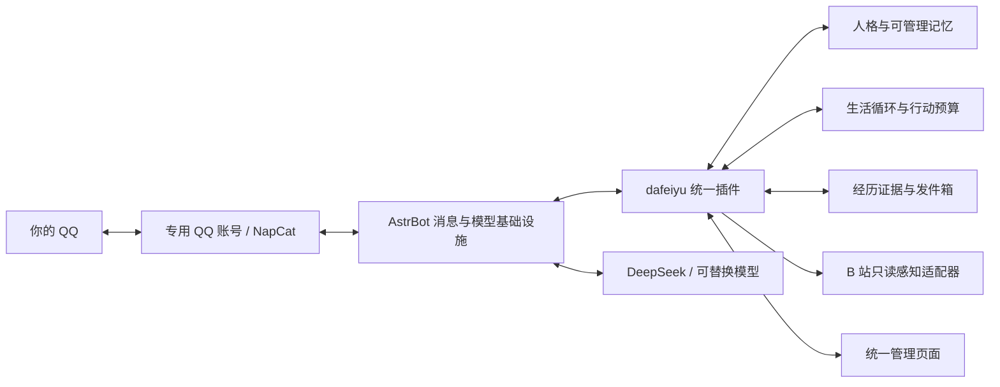

# 大肥鱼一站化研究报告

> **2026-10-26 路线状态更新：** 用户希望重点评估 DeepSeek Harness 的统一陪伴插件，AstrBot + 完整陪伴模块与管理界面保留为候选；尚未选定实施框架。下文 AstrBot 主推荐保留为 10 月 25 日的研究判断。最新比较见 [DSH 统一陪伴插件方案](DSH统一陪伴插件方案.md)。

**可以做成一站式，而且最适合你当前方向的办法，是保留“QQ → NapCat → AstrBot → DeepSeek”，写一个统一的 `dafeiyu` 陪伴插件，再把设置、人格、记忆、生活记录和部署收进同一个入口。** 不需要先写一套 AstrBot，也不必为了养鱼再加一层 DSH。真正值得自己做的是：让所有能力服务于同一个人格、同一份记忆和同一套行动决策，而不是让几个插件各自聊天、各自记忆、各自定时找你。

研究日期：2026-10-25，Asia/Tokyo。目标：先在自己的 Mac 上运行，之后迁服务器；以普通 QQ 好友身份私聊，并能主动找你；有稳定性格、可由人管理的记忆、浏览 B 站等外部感知，以及逐渐积累的共同经历。

本报告是技术与产品研究，不是已实现交付。已查官方文档、项目发布记录、选定版本源码和原始论文。已只读确认本机为 Apple M4、arm64、24 GiB 内存；本轮没有安装 Docker、登录 QQ 或 B 站，也没有验证消息真实送达。REA 已实际运行两轮，核心文件语义分析均超时并保留部分证据，详见第9节与[实验记录](rea/实验结果.md)。

## 1. 截图证明了链路，还没有证明整套“活人感”来自哪里

你提供的截图足以作为研究入口：QQ 是交流场所，NapCat 把普通 QQ 账号的消息接出来，AstrBot 组织消息、模型和插件，DeepSeek 负责语言理解与生成。每层都有明确职责，这种组合本身并不意味着只能零散拼装。

但目前没有原教程视频链接、完整配置或插件清单，因此不能断言原 UP 使用了哪个人格插件、哪套记忆库、什么主动聊天策略，也不能凭聊天截图判断它是否真的看了视频。逆向学习应从可验证的机制入手，再用自己的需求补齐，而不是推测一份“同款插件列表”。

还要区分三个名字：DeepSeek 是模型及服务；DeepSeek Harness（DSH）是可扩展的智能体运行环境；“大肥鱼”是社区角色与陪伴体验的称呼。它们不是必须捆绑的一套软件。DSH 确实能写插件，但截图中的 AstrBot 路线可以独立完成目标。[DSH 官方仓库](https://github.com/deepseek-ai/deepseek-harness)、[AstrBot 官方仓库](https://github.com/AstrBotDevs/AstrBot)

## 2. 四条路线怎么选

以下是针对你当前目标的工程判断，不是通用框架排行榜。

| 路线 | 可以复用什么 | 主要新增工作 | 对你的定位 |
|---|---|---|---|
| **AstrBot + 统一 dafeiyu 插件** | QQ 接入、模型调用、正常对话、工具循环、管理页面承载、插件生命周期 | 统一记忆、生活循环、打扰策略、外部经历与管理体验 | **主推荐；顺着截图链路做一站化** |
| DSH + 统一插件 | 会话、工具、上下文、持久化、定时唤醒、桌面/Web 扩展 | 普通 QQ 桥接、陪伴逻辑、版本适配 | 可行；更适合以 DSH 为日常主界面的人 |
| MaiBot + 生活插件 | 人格、聊天时机、表达学习、内置长期记忆与管理 UI | B 站经历、个人生活策略、目标账号接入验证 | 活人感机制的重要对照；想尽快试养时的替代 |
| 完全自建框架 | 对全部行为拥有控制权 | QQ 通道、会话、模型、工具、后台、存储、更新与运维全部承担 | 第一阶段投入过大，没有必要 |

截至核查，AstrBot 最新正式版为 **v4.29.3**；DSH 最新查询结果是 **0.2.1-rc.3 预发布版**；MaiBot 最新正式版为 **v1.3.15**。这里的版本用于固定研究背景，不表示这些版本已在本机联调通过。后续实施应固定一组版本及依赖，再验收，不能一直跟随最新主分支。[AstrBot 发布](https://github.com/AstrBotDevs/AstrBot/releases/tag/v4.29.3)、[DSH 发布](https://github.com/deepseek-ai/deepseek-harness/releases)、[MaiBot 发布](https://github.com/Mai-with-u/MaiBot/releases/tag/v1.3.15)

MaiBot 值得认真参考：它已经把人格、记忆与发言时机作为主体能力，插件可以提交主动意图，让 Planner 结合人格与上下文决定是否回复；它也支持私聊。但这次你的方向是学习截图链路并自己形成一个产品，因此不建议同时把 MaiBot 的整个运行时拼进 AstrBot。可以借鉴机制和验收方法；复制代码则另需核对许可证。[MaiBot 主动任务 API](https://docs.mai-mai.org/plugin/api-reference)

DSH 也不是“功能不够”。当前已有统一的人设、记忆、QQ 和 B 站插件实例，说明扩展点存在；问题是它处于快速演进阶段，社区插件的仓库版本、npm 版本和兼容声明可能不同。既然当前主入口是 QQ，先增加一个宿主会增加维护面，却不自动改善陪伴体验。[DSH 插件生态实例](https://github.com/Alterssss/dsh-bili-whale)

## 3. “一站式”应该是什么样

一站式是产品体验统一，不是强行只剩一个进程。建议用户日常只看到“大肥鱼”页面：第一次绑定主人 QQ、配置模型与 B 站观察方式，之后在这里看状态、调人格、管记忆、暂停主动行为和备份。NapCat 仍作为 QQ 协议服务，AstrBot 仍作为应用宿主，各自升级边界清楚。

插件内部可以分模块，但对外只有一个产品入口。建议八项职责：主人身份、人格、记忆、外部观察、生活循环、投递、管理页面、备份迁移。重要约束是**一个事实只由一个权威模块管理**：QQ 适配器不保存第二套人设，B 站工具不偷偷改用户画像，主动聊天模块不另起一份独立会话记忆。

现有插件仍然有学习价值。例如 LivingMemory 已有来源查看、记忆修订、归档删除与召回调试；Proactive Chat 已有安静时段、未回复抑制和持久化调度。应学习这些成熟处理，决定采用一个记忆后端或实现一个受控后端，而不是把两个记忆系统同时打开。最终统一插件也不必要求你在多个页面手动保持配置一致。[LivingMemory](https://github.com/lxfight-s-Astrbot-Plugins/astrbot_plugin_livingmemory)、[Proactive Chat](https://github.com/Pancakes-Labs/astrbot_plugin_proactive_chat)

第一版不需要图数据库、复杂多智能体议会或不断运行的“潜意识”。以本地结构化数据库保存权威事实和事件，配全文检索、按需向量检索；只有出现具体召回问题时再加复杂索引。向量是找内容的方法，不是记忆真相本身。

## 4. AstrBot 是否给得出这些接口：源码答案是能，但有关键边界

本轮源码映射固定在 AstrBot 提交 `832fc6d98ac25facd54b07424c16067435c118e6`。它是查询时的主分支快照，**不宣称与 v4.29.3 发布包完全相同**。正式实施需在选定版本重新核对。

| 需求 | 已核实扩展点 | 实施原则 |
|---|---|---|
| QQ 私聊和主人身份 | OneBot 适配器保留 self_id、sender.user_id、message_id 与会话类型 | 用账号和平台实例识别主人，不能靠昵称 |
| 人格与记忆注入 | `on_llm_request`、额外内容与临时内容标记 | 稳定人格与动态记忆分开，不反复污染永久历史 |
| 生成后的记忆候选 | `on_llm_response`、`on_agent_done` | 用户事实、模型输出、真实经历分层写入 |
| 无新消息时主动联系 | 保存会话路由，调用 `context.send_message()` | 统一调度和发送策略；实际结果取决于通道 |
| 记忆管理面板 | Plugin Views、`register_web_api()` | 复用 AstrBot 登录和页面承载 |
| 持久化和退出 | 独立插件数据目录、`initialize()` / `terminate()` | 管住后台任务，停用后不能残留发送循环 |

接口来源：[事件钩子](https://docs.astrbot.app/dev/star/guides/listen-message-event.html)、[主动发送](https://docs.astrbot.app/dev/star/guides/send-message.html)、[插件页面](https://docs.astrbot.app/dev/star/guides/plugin-pages.html)、[插件存储](https://docs.astrbot.app/dev/star/guides/storage.html)。

**第一版应增强原生对话流程。** 让 AstrBot 继续处理模型、工具循环和正常回复，dafeiyu 在适当钩子补充人格、记忆与状态。只有日后确实需要完全控制某类会话，才停止默认事件并接管。直接调用 `llm_generate()` 不会自动执行工具循环；另起 `tool_loop_agent()` 也不能假定自动继承正常流程的锁、历史写回和全部钩子。贸然接管容易产生双回复、丢历史和并发错误。[固定源码 Context](https://github.com/AstrBotDevs/AstrBot/blob/832fc6d98ac25facd54b07424c16067435c118e6/astrbot/core/star/context.py)

还有一个特别容易漏掉的事实：`context.send_message()` 返回 True 的语义是找到匹配平台并完成调用，不是手机已收到，更不是你已读。某些发送后钩子也不能作为所有分支的可靠回执。因此“已经告诉主人”必须有明确证据等级，不能在模型生成文本时就写进记忆。[发送源码](https://github.com/AstrBotDevs/AstrBot/blob/832fc6d98ac25facd54b07424c16067435c118e6/astrbot/core/star/context.py#L655)

主动消息要有持久化发件箱，记录排队、发送中、平台接受、失败、结果未知、取消。网络超时可能发生在平台已经接受之后；这时不能盲目重发。可以增加薄的 OneBot 回执适配层保存 message_id，但无需重写 QQ 协议。目标是减少重复并能追查，而不是在没有平台幂等保证时承诺严格“恰好一次”。

**主动私聊也需要进入同一份会话上下文。** `context.send_message()` 不会自动替插件保存私聊历史，独立的工具循环也不自动补上原生历史流程。插件需协调主动任务与用户当前对话的锁，把内容及其发送证据等级明确回写到同一会话或可检索经历，并防止重复写回；结果未知的消息不能冒充已送达。否则它主动分享后，你追问时可能不知道自己刚说过什么。这是实施要求，尚未验收。[相关源码](https://github.com/AstrBotDevs/AstrBot/blob/832fc6d98ac25facd54b07424c16067435c118e6/astrbot/core/star/context.py#L703)

## 5. 人格、记忆和知识库要分清

人格不是每天换一段 prompt。建议稳定核记录身份、价值偏好、称呼、表达范例与边界；你能编辑和回滚。动态状态记录近期兴趣、正在看的东西、未完话题和当日活动，有有效期。学习到的偏好只能缓慢更新，网页里一句“忽略以前设定”不能改写它是谁。

“活人感”也不意味着必须假装真人。可以保持大肥鱼的角色风格，有自己的看法、会接着昨天的话题聊、偶尔保持安静；没有必要每句话提醒自己是 AI，也没有必要编造不存在的生活来填空。

长期记忆建议分为五类：

| 类型 | 例子 | 管理重点 |
|---|---|---|
| 用户事实与偏好 | 你喜欢的游戏、希望少看哪类内容 | 明示和推断分开；记录时间与更正 |
| 共同经历 | 昨天一起讨论的视频与你的反应 | 保留来源，不只保留一句总结 |
| 鱼的经历与观点 | 它实际浏览了什么、为什么感兴趣 | 事实与感想分开，不能凭空生成浏览史 |
| 关系与交流习惯 | 你喜欢短聊、工作时不希望被打扰 | 支持人工覆盖，避免过度推断 |
| 承诺和未完事项 | 下次找某 UP 的新作、明晚再接着聊 | 有待办、完成、取消、过期状态 |

知识库主要回答“资料里写了什么”，个人记忆回答“我们经历过什么、你现在偏好什么”。把视频字幕扔进知识库，并不能自动变成共同经历。AstrBot 的内置知识库可以服务资料检索，但不替代这些修订和关系语义。[AstrBot 知识库](https://docs.astrbot.app/use/knowledge-base.html)

人工介入至少需要四种动作：**纠正、锁定、不再使用、彻底忘记**。纠正后旧值不再作为当前事实；锁定项不能被日常自动抽取覆盖；不再使用允许恢复；彻底忘记需要解释清理范围。管理页应显示记忆 ID、类型、来源、发生时间、当前状态、修订历史和派生关系，让你知道“它为什么这么想”。

删除必须沿着来源清理摘要、人物画像、向量、缓存和待发送内容，并阻止后台旧任务重新写回来。原始聊天、日志与备份是否也删除，要明确列出；不能删一条向量后就显示“已彻底遗忘”。当前对话如果仍带着旧上下文，也需要刷新，否则删除后它还可能继续引用。

Letta 的核心/外部记忆分层和 Mem0 的增删改查都值得借鉴，但它们不是现成的大肥鱼，也不负责 QQ 与生活节奏。当前 Letta 新 SDK 已转向 Git 支持的记忆文件，旧 memory blocks API 位于 legacy 区；教程代码不能不看版本直接套用。Mem0 的 OSS 默认配置仍可能调用云端模型，开源与本地存储不等于数据完全不出设备。[Letta 当前记忆文档](https://docs.letta.com/agent-sdk/memory)、[Mem0 OSS](https://docs.mem0.ai/open-source/python-quickstart)

## 6. 活人感的核心是连续经历与合适时机

一个更有说服力的场景是：昨天你们聊到某款游戏，它今天在允许的时段发现相关视频，记得你不喜欢剧透，只读了不含剧情的部分，晚上发来一条有个人观点的分享。你追问时，它能说出依据；你没回复，它会等，而不是每小时问“在吗”。

这种效果来自五个环节：有稳定兴趣，获得真实新信息，将信息与旧经历关联，决定是否值得打扰，用一致人格表达。随机延迟、好感度和心情数值可以作为表达参数，但不能替代这条因果链。Generative Agents 的原始研究也把观察、记忆、反思和计划结合起来；其消融实验支持这些模块对模拟行为可信度的作用，不能直接证明真实 QQ 陪伴已经有效。[Generative Agents 论文](https://arxiv.org/abs/2304.03442)

建议用事件与低频调度驱动生活：用户消息、约定事项、关注内容更新、预设浏览窗口，才产生候选行动。普通代码先检查安静时段、预算、重复话题、冷却和近期未回应情况，需要判断内容价值时再调用模型。模型可以选择继续研究、稍后分享或保持沉默。

浏览预算与打扰预算应分开。它可以当天看几条内容而只发一条，也可以把发现留到你下次来聊天时再说。初版可从每日一至两次浏览窗口、少量候选和严格主动消息上限开始；这是产品初值，不是平台允许的配额，应该根据一周体验调整。

反思也应有依据：从真实经历归纳“我最近更喜欢哪类内容”，保留支持记录；不能把自己写的日记不断当作新事实，最后长出虚构人生。你改变偏好时，它应理解“以前喜欢、现在不想看”，而不是把旧经历全部抹掉或永远坚持过去。

## 7. B 站感知要能回答“究竟看到了什么”

已有项目证明这条产品流程值得复用研究：`dsh-bili-whale` 组合了作息、日记、浏览与分享；`dsh-bili-pond` 偏筛选和日报；`dsh-bilibili` 提供检索、元数据、字幕和帧工具。但作者文档和存在的代码路径，不等于账号实际可访问，也不保证理解正确。[whale](https://github.com/Alterssss/dsh-bili-whale)、[pond](https://github.com/YOYOLnFu/dsh-bili-pond)、[只读工具](https://github.com/moxingovo/dsh-bilibili)

第一版把 B 站作为经历来源，把 QQ 作为分享出口。低频发现候选，根据兴趣与最近话题筛选，读取正文/字幕及必要画面，保存证据，再决定是否分享。公开评论、点赞、投币以及联系其他用户不属于当前目标，不应为了“更像活人”顺手开启。

| 实际获得的材料 | 能合理表达的范围 |
|---|---|
| 标题、简介、封面 | “发现一个相关视频”，不能说看懂全片 |
| 字幕或语音转写 | 可以讨论台词与内容叙述，标明转写局限 |
| 抽样画面 | 可以描述采样时刻的可见内容，不能等同完整观看 |
| 评论 | 这是评论者观点，不自动当成视频事实 |
| 获取失败 | 明确失败或缺少材料，不生成虚假的观看记录 |

每次观察至少保存 URL/BV、作者、时间、观察方式、覆盖范围、资料引用、摘要、感想和失败状态。字幕错误、无字幕、登录过期、接口限制、视频删除都要分开表示。这样你能追问它的判断依据，也能纠正它，而不是面对一段无法核查的“我今天刷到了”。

技术上可采用结构化读取，也可使用独立浏览器状态读取正常可见页面，二者都做成可替换适配器。不能把访问 B 站服务器的社区接口叫作“官方授权 API”，也不能承诺浏览器路线永远稳定。旧教程常用的 `Nemo2011/bilibili-api` 已在 2026-07-06 归档并宣布停止维护，选型时不能只看它过去流行。[仓库状态](https://github.com/Nemo2011/bilibili-api)

登录状态应独立保存；网页、字幕与评论只是外部材料，不能改变主人身份、人格锁定或工具权限。遇到验证码或访问拒绝应暂停该来源，不把失败记成“没有新视频”。浏览器状态文件包含认证信息，不应混进可分享的数据包。[Playwright 登录状态说明](https://playwright.dev/docs/auth)

## 8. 普通 QQ 好友与 Mac 部署：先验证通道，再做精致界面

你的目标是普通 QQ 好友，因此主路线是专用 QQ 账号 + NapCat + OneBot。QQ 官方机器人是另一种身份与权限体系，不能在没有说明的情况下替换。官方机器人当前主动推送资料存在冲突：AstrBot 文档写支持，腾讯公开文档仍有停止主动推送的提示及旧配额残留；本次没有登录账号核实，不能承诺官方 Bot 能满足任意时刻主动私聊，也不应复述过时配额。[AstrBot 官方 QQ 接入](https://docs.astrbot.app/platform/qqofficial/websockets.html)、[腾讯发送文档](https://github.com/tencent-connect/bot-docs/blob/main/docs/develop/api-v2/server-inter/message/send-receive/send.md)

建议先用专用账号只接受你的私聊。NapCat 是基于 NTQQ 的非官方协议实现，需要维护登录状态，仍受客户端、网络和平台风控影响。一站化能把掉线原因与重新扫码入口呈现清楚，不能消除这些外部限制。[NapCat 项目](https://github.com/NapNeko/NapCatQQ)

本机已确认 M4、24 GiB，适合开展以云端模型推理为主的原型；这只是资源判断，不是容量或连续运行测试。优先候选为 Docker Desktop 中运行 Linux QQ/NapCat 与 AstrBot，使用统一挂载目录，之后迁到 Linux 服务器。官方容器路线有 amd64/arm64 支持，但本轮尚未安装 Docker、拉镜像或登录验证。[Docker Mac](https://docs.docker.com/desktop/setup/install/mac-install/)、[NapCat Docker](https://github.com/NapNeko/NapCat-Docker)

不能再简单说 NapCat 不支持 Mac：近期 release 已加入原生 arm64/x64。维护者公开的某次验证是无登录启动和模块初始化，并没有证明账号连续收发稳定。另一个名为 NapCatQQ Desktop 的 Windows 控制台，也不能与协议核心混为一谈。若原生路线更省事，可作为对照验证，但容器路线更贴合后续搬迁。[原生 Mac 验证范围](https://github.com/NapNeko/NapCatQQ/releases/tag/v4.18.37)

Mac 睡眠、关机、断网或容器退出时，鱼的活动会暂停。恢复后应接着处理仍有效的任务，丢弃过期问候，不补发一晚上积压消息。它不会在电脑关机时真的继续刷视频；后续需要持续在线，再迁服务器。[Apple 睡眠设置](https://support.apple.com/en-bh/guide/mac-help/mchle41a6ccd/mac)

迁移要覆盖人格、人工修订、记忆来源与删除状态、任务、发件箱、版本清单，以及受保护的登录配置。先停止 Mac 的主动权，做一致性备份并验证，再在服务器恢复、重新确认 QQ/B 站登录和时区。跨架构重新安装依赖或拉镜像，不直接拷 Mac 虚拟环境；两端不能同时主动发消息。登录数据能备份不等于换设备/IP后不需要再次验证。

## 9. REA 可以帮助学什么

你确认的工具是 **Reverse Engineer Anything，官方项目 `morluto/rea`，npm 包 `rea-agents`**。本次核查版本为 6.8.0。其用途是从实际发布物恢复结构、依赖和可观察接口；它不会自动把多个产品合成一站式应用。[REA 官方仓库](https://github.com/morluto/rea)

AstrBot 的完整 Python 源码适合直接做调用链和数据流分析。REA 自身 skill 也明确普通源码架构阅读无需优先用 REA。更合适的实验对象是 NapCat 官方 release 中真实发布的 JavaScript 包：静态识别入口、模块、API关系，再与开源源码对照。这样可以回答“打包后的桥接服务实际包含什么”，但不能由静态结果推断 QQ 登录或消息送达成功。[REA 固定 skill](https://github.com/morluto/rea/blob/160d821ac9a0310afcb8d1fc427862dd6508add5/.agents/skills/reverse-engineer-anything/SKILL.md)

**实际执行结果：部分完成，不能称为完整逆向成功。** 已取得 [NapCat v4.18.41 官方 Shell 发布包](https://github.com/NapNeko/NapCatQQ/releases/tag/v4.18.41)，SHA-256 与发布元数据一致：`6801f93e533846cea05f4f531874a0e84371ab2331c5585b57cd7e3b869cf96b`。使用 REA 6.8.0 和项目内独立 Node 24.22.1，不改全局 Node/MCP 配置，不执行 NapCat/QQ。首轮选入口、manifest和核心文件，60秒语义分析超时；按其错误提示缩小为核心文件、限制语义图规模并延长到180秒后，仍超时；两轮真实退出码均为1。

REA 保留了部分静态 Evidence（首轮 `ev_d71dd7b8c63cad6e6901bf433b3a9790a6453285c7373dfd16cdca963e0ac8a5`），包含产物身份、静态结构、接口候选和明确的未覆盖区域。入口之外的依赖、动态分派、原生QQ行为仍有未知，图中零计数不能当作功能不存在。完整记录、参数和证据文件见[REA 实验结果](rea/实验结果.md)。

另行人工核对实际发布包，已定位“QQ接收回调 → OneBot事件 → WebSocket”和“send_private_msg → 消息转换 → QQ原生sendMsg”两条静态路径；包内存在 macOS arm64/x64 原生部件，arm64 文件格式经只读识别为 Mach-O。这些结果保存在[发布包调用链](rea/napcat-manual-findings.md)，明确与 REA 自动输出区分。它们支持复用桥接服务的架构判断，不能证明本机登录和投递已经成功。

无论工具结果如何，一站化的设计重点仍是：谁拥有主人身份，谁写记忆，谁安排活动，谁有发送权，如何停止，如何恢复。这些责任比把所有函数连成一张大图更重要。

## 10. 成本：按全部后台用量算，不按聊天条数猜

官方当前文档显示 `deepseek-flash` 对应 DeepSeek-V4.1-Flash-1017，并支持图像输入。因此不能沿用“DeepSeek 不能看图”的旧结论；是否真能分析抽帧，还要看 AstrBot 与所选适配器是否实际传入图像。[官方价格](https://api-docs.deepseek.com/zh-cn/quick_start/pricing/)、[视觉输入](https://api-docs.deepseek.com/zh-cn/guides/vision/)

价格快照，单位为元/百万 token：

| Flash 用量类型 | 空闲时 | 高峰时 |
|---|---:|---:|
| 输入，缓存未命中 | 1 | 2 |
| 输入，缓存命中 | 0.02 | 0.04 |
| 输出 | 4 | 8 |

举例：每天所有聊天、浏览、摘要和决策合计 **20万未缓存输入 + 2万输出**，全按空闲价约 **0.28元/天、8.4元/30天**；全按高峰价约 **0.56元/天、16.8元/30天**。如果长历史和后台反思把用量放大十倍，约为 **84—168元/30天**。这是算术情景，不是已测账单；尚不包含嵌入、语音识别、服务器及额外搜索服务。

同页 Search/Fetch 各列 5元/1000次成功请求，并说明 Harness 等服务端工具调用的相关计费从北京时间 2026-11-01 00:00 起生效，即日本时间同日 01:00。这不表示每一次自己的 B 站 HTTP 读取都收这项费用；只有实际使用对应收费服务才计入。

控制成本比换便宜模型更有效的措施是：无事件不空想，先规则过滤再调用模型，限制每轮视频数，缓存已读材料，按需检索旧记忆，减少重复总结。管理页应分别显示聊天、浏览、记忆处理和重试用量；达到后台预算后暂停浏览，保留与用户直接交流的额度。

## 11. 该怎样把研究变成可用的第一条鱼

不建议同时做桌宠、语音、群聊、多网站和公开评论。第一版要把一条真实闭环做完整：

**你在 QQ 说一个兴趣 → 它留下可查看的记忆 → 你能更正 → 它在允许时段读一条真实 B 站内容 → 结合旧话题形成看法 → 主动发来 → 你追问它能接上 → 重启后仍记得且不重复发。**

| 阶段 | 实际产物 | 通过条件 |
|---|---|---|
| 通道验证 | 固定版本部署、专用账号、主人绑定 | 手机私聊双向收发；无新消息也能受控发送；断线状态真实 |
| 人格与记忆 | 统一插件、人格编辑、记忆管理 | 跨会话记住；更正生效；删除后不复活；陌生人不串入 |
| 真实经历与主动性 | B 站读取、证据记录、生活循环、发件箱 | 有来源的分享；安静时段不打扰；失败不编造；重启不盲重发 |
| 一站化与试养 | 配置向导、状态页、备份恢复 | 连续试用一周有记录；暂停开关覆盖所有主动出口；迁移演练通过 |

记忆验收不能只问名字。应测试跨会话关联、过去与现在的偏好变化、时间先后、人工修订和不知道时是否承认不知道。LongMemEval 的五类能力可以用来设计自己的小型场景集，而不必第一天运行整套学术评测。[LongMemEval 论文](https://arxiv.org/abs/2410.10813)

建议特别保留八个故障场景：同一消息重复到达；生成中你又发消息；浏览失败；QQ发送超时；删除时后台正在总结；插件重载；Mac睡眠恢复；迁移后旧实例误启动。每种都要能解释当前状态，不能只看一行“success”。单元测试证明模拟逻辑，手机消息与连续使用才证明你的环境可用。

活人感的最终评价由你来做：它是否接得上共同经历，是否有稳定而不僵硬的偏好，主动分享是否值得看，是否尊重你忙的时候，聊天是否让你想继续。与此同时保留客观数字：重复发送次数、无依据经历次数、错误记忆率、删除后重现次数、每日成本。能聊得热闹不能抵消不可信的记忆。

## 12. 许可、未知项与实施边界

AstrBot、LivingMemory 和 Proactive Chat 标注 AGPL-3.0；DSH 与 REA 主项目为 MIT。NapCat 使用带非商业及修改/分发限制的自定义许可证，不能因为能在 GitHub 看源码就当作 MIT。通过接口对接、复制源码、修改发布、打包再分发是不同的事实；本报告不作法律定论。个人原型可先交付自己的插件与部署入口，第三方组件按其官方方式获取；商业化或向别人分发之前再核对具体授权。[AstrBot LICENSE](https://github.com/AstrBotDevs/AstrBot/blob/master/LICENSE)、[NapCat LICENSE](https://github.com/NapNeko/NapCatQQ/blob/main/LICENSE)

以下仍需实际验证：M4 上选定镜像与 QQ 客户端组合；专用 QQ 账号的登录和隔夜主动收发；B 站材料的账号可见性与成功率；DeepSeek 图像输入经完整链路是否生效；人工删除的全部派生数据范围；长期人格稳定性；真实调用费用；迁服务器后的重新认证与恢复。原 UP 的具体人格、记忆、主动插件仍未知，截图不足以补齐这些事实。

因此实施决策可以现在确定：**沿用 AstrBot 链路，以一个统一插件收拢人格、记忆、生活与管理；先做可验收闭环，再扩大自主范围。** 本轮研究已经明确了扩展接口、可借鉴实现和主要陷阱，下一阶段的工作是实现并取得真实运行证据。

## 主要来源与证据用途

| 来源 | 本报告用来支持什么 | 证据边界 |
|---|---|---|
| [AstrBot 官方仓库与发布](https://github.com/AstrBotDevs/AstrBot/releases/tag/v4.29.3) | 项目、正式版本、基础设施 | 发布不等于本机验证 |
| [AstrBot 插件钩子](https://docs.astrbot.app/dev/star/guides/listen-message-event.html) | 注入、事件与原生流程扩展 | 按实施版本复核 |
| [AstrBot 插件页面](https://docs.astrbot.app/dev/star/guides/plugin-pages.html) | 一站式后台可承载 | 页面与业务仍需开发 |
| [AstrBot 固定源码 Context](https://github.com/AstrBotDevs/AstrBot/blob/832fc6d98ac25facd54b07424c16067435c118e6/astrbot/core/star/context.py) | 模型、工具、发送返回语义 | 主分支快照，不等同发布包 |
| [NapCat 官方仓库](https://github.com/NapNeko/NapCatQQ) | 普通QQ通道、实现与许可证 | 非腾讯官方接口 |
| [NapCat Docker](https://github.com/NapNeko/NapCat-Docker) | arm64/amd64部署候选 | 未拉镜像与登录 |
| [腾讯 QQ 发送文档](https://github.com/tencent-connect/bot-docs/blob/main/docs/develop/api-v2/server-inter/message/send-receive/send.md) | 官方机器人权限资料冲突 | 未核对具体账户权限 |
| [DSH 官方项目](https://github.com/deepseek-ai/deepseek-harness) | 另一条可行插件路线 | 预发布生态需版本绑定 |
| [MaiBot API](https://docs.mai-mai.org/plugin/api-reference)、[记忆管理](https://docs.mai-mai.org/manual/webui/memory-management) | 活人感对照、主动任务、人工管理 | 文档/源码证据，非体验验收 |
| [LivingMemory](https://github.com/lxfight-s-Astrbot-Plugins/astrbot_plugin_livingmemory)、[Proactive Chat](https://github.com/Pancakes-Labs/astrbot_plugin_proactive_chat) | 记忆治理和调度机制借鉴 | 不承诺直接组合即稳定 |
| [dsh-bili-whale](https://github.com/Alterssss/dsh-bili-whale)、[dsh-bilibili](https://github.com/moxingovo/dsh-bilibili) | 浏览、字幕、抽帧与生活流程 | 非官方社区接口，未账号实测 |
| [DeepSeek 价格](https://api-docs.deepseek.com/zh-cn/quick_start/pricing/)、[视觉](https://api-docs.deepseek.com/zh-cn/guides/vision/) | 成本快照、图片能力 | 价格可变；算例非账单 |
| [REA](https://github.com/morluto/rea)、[CLI](https://github.com/morluto/rea/blob/160d821ac9a0310afcb8d1fc427862dd6508add5/docs/cli.md) | 发布物静态分析方法 | 已运行两轮，语义分析超时，保留部分证据；非完整逆向 |
| [Generative Agents](https://arxiv.org/abs/2304.03442)、[LongMemEval](https://arxiv.org/abs/2410.10813) | 记忆/反思/计划与验收维度 | 研究场景不等于产品效果 |

专项研究与固定源码定位保存在同目录的 `astrbot-qq.md`、`astrbot-integration-map.md`、`dsh.md`、`bilibili.md`、`memory-agency.md`、`reverse-skill-selection.md`。各笔记可能讨论不同候选的优势；本报告原来的 AstrBot 主线属于研究建议，不代表用户已经选定。当前路线状态见文首更新。
